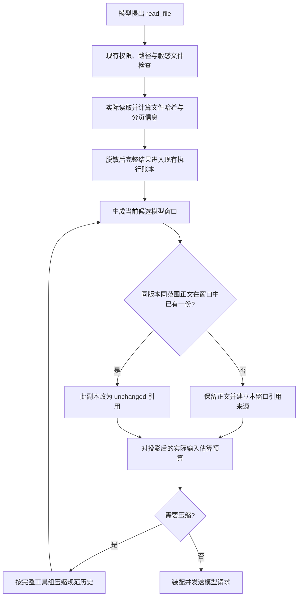

# 文件读取结果复用：源码依据与实施设计

状态：首版已实施并通过回归；文件读取执行逻辑保持真实读取。日期：2026-10-24。

实施结果见 [验证报告](read-result-reuse-report.md)；可复现样例与模型结果见
[评测记录](evaluations/read-result-reuse-20261024.json)。

## 核对范围与结论

本次固定核对 Codex `970111f6cb62cc02fe36a82ea7d71b37a2889c97`（main 提交时间 2026-10-23 UTC）和 Hermes `5894e750c3dba980d43b25aa29e3958149ba2c61`。

Codex 与 Hermes 的实现不同，不能把“文件未变化就返回 unchanged”说成两者共有的机制。以下将已核对源码与 tsm-agt 的适配设计分别说明。

## 开源实现

### Codex：工具执行记录与模型历史分层

- [官方 Codex Prompting Guide](https://developers.openai.com/cookbook/examples/gpt-5/codex_prompting_guide) 的 Exploration and reading files 部分要求先规划所需读取，再批量读取，新增线索出现后继续探索。这是模型行为指令，不是文件缓存协议。
- [ExecCommandHandler](https://github.com/openai/codex/blob/970111f6cb62cc02fe36a82ea7d71b37a2889c97/codex-rs/core/src/tools/handlers/unified_exec/exec_command.rs) 的 `handle_call` 调用进程管理器，将实际执行结果返回；这条路径未见针对文件路径、行范围和文件哈希的 unchanged 分支。该结论限定在核对过的命令执行路径，不扩展到所有 MCP、插件或外部文件工具。
- [ContextManager 历史记录](https://github.com/openai/codex/blob/970111f6cb62cc02fe36a82ea7d71b37a2889c97/codex-rs/core/src/context_manager/history.rs) 的 `record_annotated_items` / `record_item_with_metadata` 明确区分原始 rollout 与 live history：后者可以裁剪工具输出，原始记录仍保留。逐项入历史的逻辑不是按文件内容去重。
- [压缩实现](https://github.com/openai/codex/blob/970111f6cb62cc02fe36a82ea7d71b37a2889c97/codex-rs/core/src/compact.rs) 构建 replacement history，并调用 `replace_compacted_history`。曾经出现于 transcript 中，不等于压缩后仍在模型窗口中。

这里借鉴的是审计记录与模型输入分层、压缩后按实际窗口处理来源。不会声称 Codex 已实现 Hermes 式文件去重。

### Hermes：文件工具去重、历史正文去重、压缩后恢复

- [文件工具](https://github.com/NousResearch/hermes-agent/blob/5894e750c3dba980d43b25aa29e3958149ba2c61/tools/file_tools.py) 的 `read_file_tool`：先检查访问边界和文件种类；以实际路径、offset、limit 查去重状态；文件元数据一致且本代已经返回过正文时，走 `_dedup_stub_or_block`。
- 同一文件里的简短结果包含 `status=unchanged`、`dedup=true`、`content_returned=false`。再次反复命中会触发专门的 guardrail refusal；这是 Hermes 的防循环策略，不等同于普通 I/O 失败。
- [读取跟踪](https://github.com/NousResearch/hermes-agent/blob/5894e750c3dba980d43b25aa29e3958149ba2c61/tools/file_tools_read_tracking.py)：快判使用设备、inode、size、纳秒 mtime/ctime；字节基线检查另外使用 SHA-256。不能说每次去重命中都会重算文件 SHA。
- [压缩边界](https://github.com/NousResearch/hermes-agent/blob/5894e750c3dba980d43b25aa29e3958149ba2c61/agent/conversation_compression.py) 的 `_reset_read_dedup_caches` 调用 `reset_file_dedup`。该函数保留版本映射，清除“本代已返回正文”的集合，允许压缩后的首次恢复读取返回正文。这是代际状态管理，不是每次扫描最终请求来证明可见性。
- [压缩器](https://github.com/NousResearch/hermes-agent/blob/5894e750c3dba980d43b25aa29e3958149ba2c61/agent/context_compressor.py) 的 `_dedupe_tool_results` 在字符串工具输出中保留较新副本，将旧的相同正文改为短说明。它按正文摘要识别，不是文件版本检查；多模态等非字符串形状不走该路径。

因此，Hermes 本身也同时存在工具侧和上下文侧两种去重，不能只概括为“模型自己决定”或“工具自己决定”。

## tsm-agt 第一版采用的流程

采用：真实读取并保留完整结果，在模型请求投影中折叠同版本、同范围的重复文件正文。吸收 Hermes 的显式引用语义、Codex 的原始记录与模型历史分层。

第一版目标是减少重复模型输入，不跳过本地文件 I/O，不引入跨进程文件正文缓存。现有 `core.read_file` 已经读取字节并计算 SHA-256，直接使用这些事实即可；这能避免先引入文件监视器、stat 缓存失效与新持久化存储。



### 匹配条件

只处理明确的 `core.read_file` 成功文本结果。匹配键包括：

1. Task、实际工作区/批准读取根、规范化文件路径。
2. 本次实际读取的整文件 SHA-256。
3. 请求范围和实际返回范围，包含行、列及分页游标。
4. 模型实际可见正文的 SHA-256，防止脱敏或展示变换后错误等同。

失去可靠来源、哈希、正文或范围的记录不折叠。文件名相同、参数指纹相同、搜索摘要相同都不足以命中。空正文和很短正文直接保留，只有替换后的引用确实更短时才折叠。

分页读取只复用实际返回的同一段，保留 `truncated`、`next_cursor`、`total_lines` 等信息；不会把“读过一页”表示成“看过整份文件”。不同文件即使内容一致也不合并。

### 来源选择与压缩恢复

扫描当前候选规范历史，保留每个匹配键最早仍然存续的正文，后续副本引用它。这里有意不同于 Hermes 压缩器保留较新副本的策略：正常追加新调用时，尽量不改写已经发送过的前缀。依据是 [OpenAI Prompt Caching 文档](https://developers.openai.com/api/docs/guides/prompt-caching) 所说明的匹配前缀要求；这不是宣称所有供应商均有同样缓存收益。

每次预算压缩、回退、截断、恢复或重建历史后，都从剩余的规范结果重新投影：

- 旧来源仍在：继续引用。
- 旧来源被丢弃、但另一个相同完整结果还在：该结果自动成为新的正文来源。
- 当前窗口只剩摘要或引用：不能把它当作正文；后续实际读取返回的正文保留。

引用必须指向本次实际请求中保留的正文，不只检查 message_id 是否存在。摘要、裁剪后的不完整范围、磁盘上的审计记录都不能单独证明模型看得见原文。

压缩不得在预算完成后额外补入正文：每次候选窗口变化后重新投影并重新计费，再决定是否继续压缩。

### 结果语义

下列是我们的模型输入投影示例，不是 Codex 的现有返回协议：

```json
{
  "call_id": "read_002",
  "ok": true,
  "data": {
    "status": "unchanged",
    "path": "src/app.py",
    "sha256": "same-file-version",
    "start_line": 1,
    "end_line": 200,
    "content_returned": false,
    "reused_from_call_id": "read_001"
  },
  "message": "此读取与 read_001 的文件版本和返回范围一致，正文已保留在本次上下文中。"
}
```

实际投影继续保留原结果的必要路径解析字段、分页信息、事实来源和本次独立 call_id。原始账本记录仍包含本次真实读取的完整结果；这里的 `content_returned=false` 限定为模型投影未再次发送正文，不代表没有实际执行读取。

引用不是文件正文，不授予写入权限，不作为全文件已读凭证。写入仍使用原有 expected_hash/patch 冲突检查。普通重复读取不改成工具失败；第一版不引入 Hermes 的重复次数硬拦截。

## 现有代码与具体改动位置

| 位置 | 实施改动 |
| --- | --- |
| `src/tsm_agt/adapters/builtin/core_tools.py::_read_file` | 保留真实读取、权限检查、分页与 SHA；确保来源字段足够，不在这里根据隐含模型上下文返回引用。 |
| 新增 `src/tsm_agt/core/read_result_reuse.py` | 纯投影：建立匹配键、选择正文来源、折叠重复副本、生成不含正文的诊断统计。无磁盘缓存、无事件写入。 |
| `src/tsm_agt/core/context.py::ContextWindowManager` | 预算估算与每轮压缩候选使用同一投影函数；压缩后重新选来源，保持完整工具调用/结果协议。 |
| `PreparedContext` | 区分保留的规范消息与供模型使用的投影消息，防止把引用覆盖回唯一可恢复正文。具体字段可为 retained_messages / messages。 |
| `src/tsm_agt/core/conversation_loop/loop.py::_prepare_model_call` | checkpoint 保存保留的规范消息；ModelRequest 使用最终投影。调用链不得在预算后再次改变正文布局。 |
| `src/tsm_agt/core/kernel_tool.py` | 继续记录完整原始结果；现有 `tool.result_reused` 只表示同 call_id 的幂等恢复，与内容重复折叠分开统计。 |
| `src/tsm_agt/core/prompt_templates/workspace.md` / 读取工具说明 | 简短说明 unchanged 引用含义，优先复用已见正文；需要其他范围时正常读取，不要求模型自行声称版本没变。读取规则版本更新为 1.1。 |
| 三种供应商序列化测试 | 验证当前调用与结果仍匹配，引用来源的正文实际存在，Responses reasoning / Anthropic 协议块保持完整。 |

现有 `DefaultToolResultGovernor` 继续只负责脱敏；不重新加入无声明的截断或去重。历史规范消息、审计账本和模型投影是不同职责。

## 首版范围与验收

首版只覆盖文件文本读取；搜索、命令输出、MCP、Skill、图片/PDF 不按同一规则自动折叠。它们的版本、可见性及副作用需要分别建立契约。也不在这一改动里增加并行执行器。

必测场景：

1. 相同文件、版本、分页，两次不同 call_id：模型请求含一份正文，另一份引用；账本两次完整结果仍在。
2. 文件修改、原子替换、相同长度外部修改或保留 mtime 的写入：新 SHA 不同则返回新正文。
3. 不同范围、不同读取根、不同 Task、不同实际路径：不误命中。
4. 分页与超长单行：范围和游标保持准确。
5. 来源被压缩、回退或裁剪：剩余正文重新成为来源；不得出现找不到正文的引用。
6. checkpoint/进程恢复：从规范消息恢复，不把旧引用直接当成“已见正文”。
7. 权限变化、敏感文件、失败结果：仍走现有检查；不通过复用绕过读取边界。
8. 脱敏正文变化或不可证明相同：保留正常结果；不把脱敏内容作为可直接写回的完整文件。
9. OpenAI Chat、Responses、Anthropic 的最终请求：call_id 完整、正文来源存在、预算与装配一致。
10. 统计参与折叠的原始/投影工具结果 JSON 的 UTF-8 bytes、引用次数及 call_id 来源映射；来源重选通过映射观察，不维护跨请求计数器。估算 token 明确标注估算方法，不当作真实供应商费用。

真实模型评测使用构造工作区，比较读取调用次数、重复正文输入量、压缩次数和最终修改/验证结果。减少输入 bytes 不自动证明模型更容易执行到底，行为效果必须另外测量。
