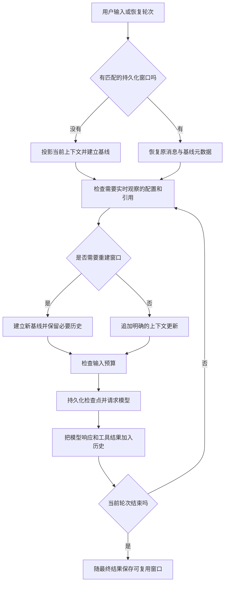

# Agent 每次都重建上下文，Prompt Cache 为什么难命中？从动态快照改为持久化窗口

> 本文要解决的问题：模型调用之间只新增了一次工具结果，应用却重新拼装任务进度、工作记忆、能力目录和历史摘要，导致前面的请求内容反复变化；重启后还可能用新的快照重建旧会话。我们引入可持久化的上下文窗口，明确区分窗口快照、历史结果、增量更新和重建边界。
>
## 一、这次要解决的到底是什么问题

假设模型刚刚通过 Todo 工具完成第一项任务。

下一次请求已经会携带这次工具结果，结果中有最新清单和修订号。但应用又重新生成一份完整进度视图，再把它放到历史对话之前。

请求就可能从：

```text
基础指令 → 任务进度 A → 历史消息 → 当前输入
```

变成：

```text
基础指令 → 任务进度 B → 历史消息 → 当前输入 → 工具结果
```

业务上只是多了一个结果，请求结构上却修改了历史之前的内容。

这会带来三类问题：

| 问题 | 后果 |
| --- | --- |
| 重复表达同一状态 | 模型同时看到工具结果和新生成的整份快照 |
| 变化发生在历史前面 | 可复用前缀被更早截断，缓存行为难以解释 |
| 重启重新取快照 | 同一段会话在恢复前后可能对应不同的模型输入 |

只把变量改名为 `stable_prefix`，或者只计算静态系统提示词的哈希，无法证明实际请求稳定。

## 二、先区分两种完全不同的“缓存”

本文把原样保存的上下文消息称为应用侧基线。它解决的是：应用下一次还要发送什么，以及能否复原。

模型提供方的 Prompt Cache 是另一层机制。官方说明指出，它复用匹配的已缓存渲染前缀；工具定义及相关设置也会影响匹配。相同的应用消息前缀并不自动证明服务端命中。[OpenAI Prompt Caching 文档](https://developers.openai.com/api/docs/guides/prompt-caching)

所以这里的工作顺序应当是：

```text
先让应用请求可解释、可恢复
  → 再检查实际提供方请求有没有变化
  → 最后读取 API 返回的缓存用量，评估成本和延迟
```

不能跳过中间两步，直接把“哈希没变”写成“缓存命中率提高”。

## 三、用“窗口”明确稳定的范围

这套实现区分三种生命周期：

| 名称 | 范围 | 结束条件 |
| --- | --- | --- |
| Session | 用户看到的一段会话容器 | 会话关闭或归档等 |
| 用户轮次 | 一次用户输入，以及为此进行的模型和工具交互 | 这次交互结束或中断 |
| 上下文窗口 | 一份基线及其后续历史 | 压缩或有效配置、受信指令等变化触发重建 |

窗口可以跨越多条用户消息，但不是跨所有任务、模型和配置永久共享。

当前窗口身份包含任务 ID、模型配置名、工作区、提示词清单哈希、工具名称与定义、推理强度等信息。适配器提供模型配置指纹时，也把指纹纳入身份。

这说明了两个限制：

- 同一 Session 内的新任务，不一定能复用原窗口。
- 适配器没有暴露的远程配置变化，应用不能仅靠本地身份哈希完全识别。

身份只用来判定能否复用上下文，不是授权凭据。

这部分实现在本地新增文件 `src/tsm_agt/core/context_window.py` 中，负责保存基线和比较上下文变化。文件尚未提交，暂不提供 GitHub 源码链接。

## 四、改造后的完整流程



预算达到压缩条件时，还会进入单独的窗口压缩流程。它会重新建立基线，而不是伪装成一次普通追加。

编排位置见 [conversation_loop/loop.py](https://github.com/tuwentao123/tsm-agt/blob/main/src/tsm_agt/core/conversation_loop/loop.py)。

## 五、动态信息不能统一规定为“有变化就追加”

后台状态可以不断变化，但模型只应收到当前决策需要的信息。

本次规则如下：

| 内容 | 初始处理 | 窗口内处理 |
| --- | --- | --- |
| 基础提示词 | 按有效工具能力组装 | 正常情况下复用 |
| 项目指令、运行环境、固定任务说明 | 建立基线 | 检测到需要更新受信指令时重建 |
| MCP 服务目录、Skill 索引 | 有预算的目录快照 | 可见目录变化时追加更新 |
| MCP 连接状态 | 后台持有 | 通过发现或调用结果观察 |
| 工作记忆、Todo | 窗口开始时取快照 | 模型自己的读写通过工具结果体现 |
| 文档引用 | 初始投影 | 引用变化时追加更新 |
| Skill 正文、MCP 参数定义 | 使用时读取 | 留在历史中，不再复制到前置提示词 |
| UI 展示进度 | 来自后台事件 | 不因界面变化反复生成模型消息 |

目录更新也有实现边界：当前是追加发生变化的有预算目录及移除的目录名，并非所有内容都实现了逐条最小差异。

Skill 正文修订值本身的变化会被排除在目录差异比较之外。目录项的名称、说明、来源等变化才影响这层可见目录；实际正文的当前版本由显式读取获得。

## 六、Todo 更新后，模型还能看到最新状态吗

可以。变化后的事实已经在工具结果里。

```text
窗口开始：Todo 快照 revision=1
模型写入 Todo
工具结果：revision=2，A 已完成，B 进行中
下一次请求：原基线 + 原历史 + 这次工具结果
```

基线会明确说明：它是窗口开始时的观察，后面的工具结果和显式更新可以替代对应旧状态。

这样，模型获得新事实的路径是清楚的，而不是靠 Runtime 每次在前面插入另一份清单。

如果状态被外部途径修改，窗口快照不会因此变成“实时数据库视图”。模型需要当前事实时应查询工具；窗口压缩或重建时也会重新取得状态。

这是一种有边界的快照策略，不是保证所有后台变化都立即自动通知模型。

## 七、为什么受信指令变化时选择重建

一个看似合理的方案是：把新的 system 消息追加在历史末尾。

但在当前 Anthropic Messages 适配器中，所有 system 内容会合并到请求前部。应用层放在末尾，不代表提供方请求里也保留相同位置。

因此，当有效配置发生变化，或者更新涉及受信 system 内容时，这套实现会显式建立新窗口，并记录：

```text
context.window_reset
reason = configuration_or_trusted_instructions_changed
```

一般目录和引用观察可以追加；受信指令则优先保证实际语义正确，并接受重建带来的缓存代价。

代码位置分别是 [loop.py](https://github.com/tuwentao123/tsm-agt/blob/main/src/tsm_agt/core/conversation_loop/loop.py)和 [Anthropic 适配器](https://github.com/tuwentao123/tsm-agt/blob/main/src/tsm_agt/adapters/anthropic_messages/model.py)。

## 八、窗口保存在哪里，重启后怎么恢复

两份持久化数据承担不同职责：

| 位置 | 保存内容 | 用途 |
| --- | --- | --- |
| `AgentTurnCheckpoint` | 消息、待执行调用、窗口身份和差异元数据等 | 轮次中断、授权等待和进程恢复 |
| `SessionSnapshot.model_context_window` | 完成轮次后的窗口消息及元数据 | 下一条用户消息复用 |

请求模型之前，先保存检查点，避免进程崩溃后用更新的文件或连接状态重新拼出“旧请求”。

轮次完成时，窗口随最终结果进入既有的会话、任务联合提交链路。

恢复旧消息时，会给一部分历史消息标记本地历史身份，避免“查找本轮用户输入”误选到上一轮输入。这些标识属于存储元数据，不作为提示词正文发给模型。

对应实现见 [agent_loop.py](https://github.com/tuwentao123/tsm-agt/blob/main/src/tsm_agt/core/agent_loop.py)、[session.py](https://github.com/tuwentao123/tsm-agt/blob/main/src/tsm_agt/core/session.py)和 [finalizer.py](https://github.com/tuwentao123/tsm-agt/blob/main/src/tsm_agt/core/conversation_loop/finalizer.py)。

恢复应用消息不代表恢复了服务端 KV 缓存。新进程的本地请求比较器也没有上一进程的内存记录，因此首次比较可能显示“没有上一请求”。

## 九、减少的不只是发送内容，还有反复投影的工作

如果消息已经冻结，但每次模型调用仍从数据库重建完整 Session 历史，再丢弃大部分结果，应用侧开销仍然存在。

本次增加 `updates_only` 路径：

- 建立基线时获取完整投影。
- 窗口内主要检查项目指令、运行环境或任务说明、文档引用。
- 不再在每次工具循环中重建整段 Session 历史、工作记忆和进度快照。
- 压缩或重建时重新获取需要的当前状态。

对应代码见 [kernel_onboarding.py](https://github.com/tuwentao123/tsm-agt/blob/main/src/tsm_agt/core/kernel_onboarding.py)。

请求级测试验证了一个具体场景：经过工具调用和下一条用户消息，完整 Session 上下文投影只执行一次。这证明该路径消除了重复投影，不等于已经测得端到端延迟下降比例。

## 十、怎样观察实际请求有没有变化

旧的 `stable_prefix_hash` 只覆盖静态系统消息，不能解释完整请求。

因此，新比较器放在提供方请求体组装之后，对选定字段和消息进行哈希比较，输出 `model.request_prefix_observed` 事件。

主要字段：

| 字段 | 含义 |
| --- | --- |
| `has_previous_request` | 当前进程内是否有对应窗口的上一请求 |
| `prefix_settings_unchanged` | 模型、system、tools 等被观察字段是否相同 |
| `unchanged_leading_messages` | 从开头连续相同的消息数量 |
| `unchanged_message_bytes` | 这些消息的规范化 JSON 字节数 |
| `message_count` | 本次消息数量 |
| `prefix_settings_hash` | 被观察设置的哈希 |

它不保存消息正文，不记录访问密钥，也不把“JSON 字节相同”当成“模型 tokens 相同”。设置比较只覆盖实现中列出的字段，无法观察提供方隐藏指令。

本地比较器保留有限数量的窗口记录，也不是一个持久化缓存系统。

请求比较实现在本地新增文件 `src/tsm_agt/adapters/request_prefix.py` 中。文件尚未提交，暂不提供 GitHub 源码链接。

## 十一、收益应该分三层报告

| 层次 | 当前能够验证的内容 | 不能据此宣称的内容 |
| --- | --- | --- |
| 应用请求稳定性 | 正常测试场景中，旧消息与工具定义保持一致 | 所有异常、切换和压缩路径都永远不变 |
| 本地组装开销 | 不再每次重建整段 Session 投影 | 整体延迟已经下降某个百分比 |
| 提供方缓存收益 | 已有请求字段比较和用量观察入口 | 真实缓存命中率、账单节省已经提升 |

官方缓存文档也提醒，缓存查找边界会影响复用；压缩重写历史后，可能只能复用更短的前缀。[缓存匹配与压缩说明](https://developers.openai.com/api/docs/guides/prompt-caching)

因此，后续在线对照至少应同时记录输入 tokens、API 缓存读取、响应延迟、模型调用次数和任务完成情况。

## 十二、这次怎么验证

请求级回归使用同一组模型输入，经 OpenAI Chat 和 Anthropic Messages 两种适配器生成实际请求体，检查：

1. 工具调用前后的原有消息是否保持一致。
2. 下一条用户消息是否继续保留已有历史。
3. 模型工具定义和 system 字段是否保持一致。
4. SQLite 重启后是否保留原选择，且本轮输入没有重复或串轮。
5. 请求观察事件是否只包含哈希和计数。

相关测试位于本地新增文件 `tests/test_context_window_runtime.py`。文件尚未提交，暂不提供 GitHub 源码链接。

这套设计最终确定的是更新边界：后台可以持续变化，模型窗口保持可解释的快照；需要的新事实通过结果和更新进入历史，必须改变基线时就明确重建。
