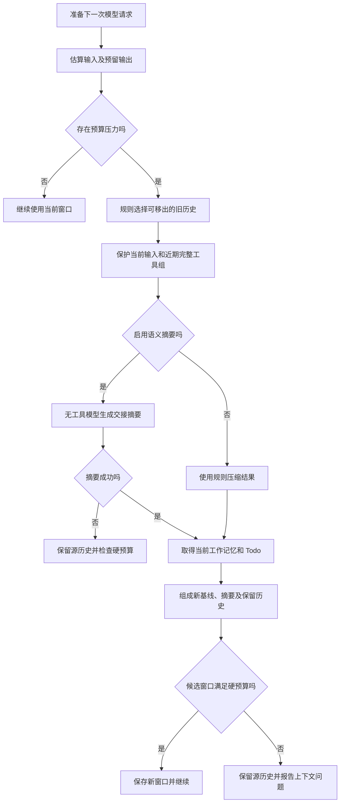

# 长会话不能只删除旧消息：给 Agent 加上可恢复的语义压缩与任务交接

> 本文要解决的问题：长会话接近输入上限时，机械裁剪可以缩短历史，却可能只留下“调用过什么”，丢掉用户约束、关键决定及未完成事项；粗暴删除还可能拆开工具调用与结果。我们在规则预算之后加入无工具的语义摘要，把压缩视为一次可验证的新窗口建立，而不是直接覆盖原历史。

## 一、压缩前先回答：哪些信息丢了会影响继续工作

考虑这样一段历史：

```text
用户：保持现有接口兼容，先改实现，不要发布。
模型：选择方案 A，因为方案 B 会改变返回结构。
工具：修改文件成功。
工具：测试失败，缺少一个边界条件。
模型：已完成实现，还需要补边界条件并重新验证。
用户：继续。
```

如果压缩只留下：

```text
assistant
tool: 修改成功
tool: 退出码非零
```

后续模型可能不知道为什么选方案 A，也不知道“不要发布”和“尚未通过验证”仍然重要。

反过来，把旧消息一股脑交给模型写摘要，也不能保证工具协议完整，更不能把摘要里的“完成了”当成真实验收结论。

这次改造要同时处理：

| 问题 | 需要的机制 |
| --- | --- |
| 输入逐渐接近上限 | 包含工具定义、图片和输出预留的统一预算 |
| 旧对话语义丢失 | 面向任务继续执行的交接摘要 |
| 调用与结果被拆开 | 完整工具批次和历史轮次的保留规则 |
| 摘要失败污染状态 | 先生成候选，再验证预算和提交 |
| 压缩后状态陈旧 | 从后台重新生成当前记忆与 Todo 快照 |
| 摘要成本被忽略 | 单独记录摘要请求及返回用量 |

## 二、改造前后的职责划分

原来的预算管理器并不是什么都不做。它已经包含历史选择、近期消息保留、工具结果摘要、重复读取内容处理，以及调用/结果分组等规则。

问题在于，它主要保留可机械提取的角色、调用、路径和错误等事实，不能充分承担“把整段任务讲清楚”的职责。

| 阶段 | 改造前 | 改造后 |
| --- | --- | --- |
| 工具输出进入历史 | 既有输出治理和读取复用 | 继续复用 |
| 历史超出预算 | 规则选择和机械摘要 | 规则先选择可移出的历史 |
| 决策和约束交接 | 可能缺少语义概括 | 增加模型生成的交接摘要 |
| 当前工作状态 | 依赖原有保护和投影 | 新窗口重新取得当前状态 |
| 摘要失败 | 没有该模型调用阶段 | 保留源历史，检查是否还能继续请求 |
| 提交时机 | 规则产出压缩视图 | 候选新窗口通过预算检查后再保存 |

这里不是用模型替换全部预算逻辑。哪些历史可以离开、工具协议如何成组保留，仍由可检查的规则决定。

## 三、什么时候触发压缩

设模型上下文容量为 `C`，本地预留输出为 `R`，估算输入为 `I`。

基本硬约束是：

```text
I <= C - R
```

同时设置较早的触发线，例如默认比例 0.8：

```text
I + R >= floor(C × 0.8)
```

实际实现还考虑历史软预算和可选的延迟软阈值，因此不能理解成“只有总量达到 80% 才压缩”。

预算也不只计算对话文本：静态指令、工具 Schema、目录、状态投影、图片预留及序列化开销都需要纳入。

当前估算器使用 UTF-8 字节等规则，不是模型提供方的精确 tokenizer。对应实现见 [ContextWindowManager](https://github.com/tuwentao123/tsm-agt/blob/main/src/tsm_agt/core/context.py)。

压缩也不能凭空缩小仍然需要完整发送的核心工具定义。如果工具 Schema 本身占满窗口，应先处理工具暴露方式；这正是 MCP 固定入口与按需发现改造的作用。

## 四、完整压缩流程



预算管理器负责选择，`complete_window_compaction` 负责异步摘要、状态刷新和候选窗口验证。

编排实现在本地新增文件 `src/tsm_agt/core/conversation_loop/compaction.py` 中。文件尚未提交，暂不提供 GitHub 源码链接。

## 五、先把“不能拆”的边界保护好

工具交互不是任意几条普通文本。

```text
assistant: 调用工具 A、B
tool: A 的结果
tool: B 的结果
```

如果只删掉调用消息，结果就成了孤立结果；只留 A 的结果，也可能破坏调用批次的完整性。

主循环会先处理完整批次或进入授权等待，不会在一个尚未收齐结果的批次中间直接发起下一次普通模型请求。

历史分组还会把已恢复的旧用户输入、该轮工具协议以及后续回答作为完整历史轮次处理。选择较近历史时，实际保留范围可能超过一个简单的消息条数。

因此，`recent_message_floor` 是保留策略的一部分，不是机械地截取最后 N 行，更不是把孤立工具结果补成新的工具证据。

对应代码见 [context.py](https://github.com/tuwentao123/tsm-agt/blob/main/src/tsm_agt/core/context.py)和 [turn_tool_batch.py](https://github.com/tuwentao123/tsm-agt/blob/main/src/tsm_agt/core/turn_tool_batch.py)。

## 六、语义摘要要保留什么

摘要提示词明确要求保留：

| 内容 | 为什么需要 |
| --- | --- |
| 当前目标、用户约束 | 防止压缩后改变任务范围 |
| 已确定的决定及理由 | 防止重复争论或选回被排除的方案 |
| 实际改动 | 知道已经动过哪些部分 |
| 验证结果和失败 | 区分实现成功、检查成功和未检查 |
| 未完成事项与下一步 | 能接着执行，而不只复述历史 |
| 路径、产物引用、工具与 Skill 名称 | 保留重新查证和读取的入口 |

同时要求区分模型自己的说法与工具观察，不推断任务完成或授权，不复制大块输出、密钥和完整 Schema。

一个交接摘要可以是：

```text
目标：修改接口实现，保持返回结构兼容；用户要求暂不发布。
决定：沿用方案 A，原因是方案 B 会改变返回结构。
已观察：相关实现文件已修改；最近一次测试仍失败。
待完成：补充空结果边界，重跑相关测试，再报告结果。
需要重新读取：如果继续调用报表 MCP，应重新发现其参数定义。
```

这只是输出示例。当前摘要是自由文本，提示词约束没有变成对所有事实逐项校验的结构化验收器。

## 七、如何防止摘要阶段执行业务动作

摘要请求使用当前选定模型配置，但显式关闭工具：

```python
ModelRequest(
    purpose=ModelCallPurpose.COMPACTION,
    tools=(),
    allow_tool_calls=False,
    model_profile_id=current_profile,
    # 其他字段按预算和调用环境设置
)
```

历史内容作为普通数据交给摘要模型。它没有文件修改、命令执行或 MCP 调用能力，也不能借摘要阶段继续办理业务。

请求携带取消作用域；摘要输入量较大时，可以分成连续数据片段，使用“上一次交接摘要 + 下一段历史”的方式滚动更新。

这里的分片与主对话协议保护不同：摘要输入是 JSON 包装的数据片段，可以在一条大文本内部切分；它不会把半个工具交互作为原生工具协议发给提供方。

输出校验包括正常结束、文本非空，以及最终 UTF-8 文本大小限制。提示词希望控制在约 700 tokens，实际请求输出上限还会根据窗口计算，范围为 512 到 4,096 tokens；这些不是同一个限制。

`ModelContextSummarizer` 位于本地新增文件 `src/tsm_agt/adapters/model_context_summary.py` 中。文件尚未提交，暂不提供 GitHub 源码链接。

## 八、摘要成功之后，也不能马上覆盖原状态

摘要成功只是一个中间结果。

新窗口还需要组合：

```text
固定基础指令和工具入口
当前能力目录
重新取得的工作记忆与 Todo 观察
历史交接摘要
需要保留的近期完整消息
必要的历史元数据
```

其中有两个容易漏掉的细节。

第一，当前状态必须来自重新观察。不能因为旧历史里有一份 Todo，就直接把它当成新窗口的当前清单。

第二，不能重新投影整段历史并全部放回。否则刚移出的旧内容会通过 Session 投影重新进入请求，压缩失去作用。

实现中会排除重新投影的整段会话历史，保留经过选择的原有历史和必要元数据，并重新计算候选窗口预算。只有候选满足硬限制，才更新窗口 epoch 和检查点。

摘要接口定义在本地新增文件 `src/tsm_agt/ports/context_summary.py` 中。文件尚未提交，暂不提供 GitHub 源码链接。

## 九、摘要是历史数据，不能升级成权限或验收结论

交接结果使用用户角色的历史数据消息包装，标记 `untrusted_historical_data` 和 `semantic_handoff`。

它可以帮助后续模型定位任务，但不能证明：

- 某项测试确实通过了。
- 用户批准了一个原本需要授权的操作。
- 服务器上的副作用已经发生或没有发生。
- 旧 MCP 定义仍然有效。

真正执行时仍查当前工具定义、策略及账本。模型需要关键证据时，也应回到对应文件、产物或工具观察。

压缩改变的是用于模型继续工作的上下文视图，不会重写已经保存的会话事件。但这不等于所有上游原始输出都有完整归档，原始输出保存能力仍由既有工具和存储机制决定。

## 十、MCP 定义和 Skill 正文被移出后怎么办

摘要可以记住“使用过哪个能力”，不应据此假定“完整定义仍在上下文中”。

例如，摘要保留了：

```text
之前使用 mcp.reports.query_dashboard 查询过演示报表。
```

如果其参数 Schema 已经被移出，模型再次使用时应重新发现。Skill 也是一样：保留名称、用途或历史结论，不代表完整正文仍然可用；需要按具体步骤继续时应重新读取。

本次没有实现“从摘要自动还原全部旧 Schema 和正文”的机制，因为那会重新引入大量内容，也可能把旧版本误当成当前版本。

## 十一、失败后保留原历史，不等于保证还能继续请求

需要明确区分几种结果：

| 情况 | 当前行为 |
| --- | --- |
| 摘要失败，但原输入仍满足硬预算 | 保留原历史，继续使用原窗口 |
| 摘要失败，原输入已超过硬预算 | 保留原历史，报告上下文问题，不发送超限请求 |
| 摘要成功，但新基线和摘要仍超限 | 不提交这个候选，报告上下文问题 |
| 摘要成功且候选满足预算 | 保存新窗口，再继续模型调用 |

因此，失败保护解决的是“不把失败产物覆盖成新历史”，并没有消除模型输入上限。

这里也没有增加一个“必须人工核对摘要后才能继续”的永久运行时门槛。摘要失败是可观察的调用或预算问题，应通过正常错误与恢复路径处理。

## 十二、配置、事件与成本

生产应用默认开启语义压缩，可以通过 YAML 调整：

```yaml
context:
  compaction_ratio: 0.8
  history_soft_tokens: 16384
  semantic_compaction: true
```

设为 `false` 时使用规则压缩路径。比例和历史软预算是不同条件，不要把 `history_soft_tokens` 理解为所有输入的总上限。

配置解析见 [context_configuration.py](https://github.com/tuwentao123/tsm-agt/blob/main/src/tsm_agt/bootstrap/context_configuration.py)，接线见 [composition.py](https://github.com/tuwentao123/tsm-agt/blob/main/src/tsm_agt/bootstrap/composition.py)。

关键事件：

| 事件 | 用途 |
| --- | --- |
| `context.summary_completed` | 记录摘要调用次数、成功返回的用量和源消息数量 |
| `context.summary_failed` | 记录失败类型和源历史保留事实 |
| `context.compacted` | 记录窗口压缩后的预算及摘要标识等信息 |

成功摘要返回的输入、输出用量会累计到轮次统计。摘要模型调用数单独记录，不把它混同于主对话迭代次数。发生失败时，实际消耗仍应以提供方返回及账单为准。

## 十三、压缩为什么可能降低缓存复用

窗口内尽量追加历史，是为了保留可复用前缀；压缩主动替换旧内容，目的则是让任务能够继续。

两者存在取舍。官方文档也说明，compaction 会改变先前上下文，可能降低旧缓存复用；它提供的原生机制与本文应用侧文本摘要并不相同。[OpenAI Compaction 文档](https://developers.openai.com/api/docs/guides/compaction)、[缓存与压缩说明](https://developers.openai.com/api/docs/guides/prompt-caching)

评估不能只看压缩率或缓存命中率，应把这些成本放在一起：

```text
摘要阶段的额外输入和输出
  + 新窗口后续请求的输入成本
  + 缓存重建造成的影响
  + 任务是否仍然正确完成
```

目前没有完成真实业务长会话的费用、延迟和任务质量对照，因此本文不提供一个通用节省百分比。

## 十四、回归验证了哪些边界

| 场景 | 验证内容 |
| --- | --- |
| 多条短历史 | 可以合并进同一次摘要请求，不机械地每条调用一次模型 |
| 摘要请求 | 无工具、用途标记为 `COMPACTION` |
| 摘要失败 | 在可继续发送时保留原消息，不提交压缩候选 |
| 摘要成功 | 新 epoch 建立，交接文本进入窗口 |
| 当前 Todo 已变化 | 新窗口包含当前修订和进行中事项 |
| 近期工具交互 | 调用与结果仍成组存在 |
| 摘要用量 | 输入、输出用量能够累加进统计 |
| 重复文件读取 | 压缩后不引用已经移出窗口的读取正文 |

新增测试位于本地的 `tests/test_context_window_runtime.py`，尚未提交，暂不提供远程链接。已有测试文件可参考 [test_context_compaction.py](https://github.com/tuwentao123/tsm-agt/blob/main/tests/test_context_compaction.py)和 [test_read_result_reuse.py](https://github.com/tuwentao123/tsm-agt/blob/main/tests/test_read_result_reuse.py)。

这些自动化测试验证了预算、协议、持久化和状态交接路径。它们没有证明模型摘要不会遗漏事实，真实任务仍需要质量评估。

压缩的落点应当是一份有来源、保留继续工作所需信息、且能重新查证的交接记录，而不只是更短的聊天文本。
