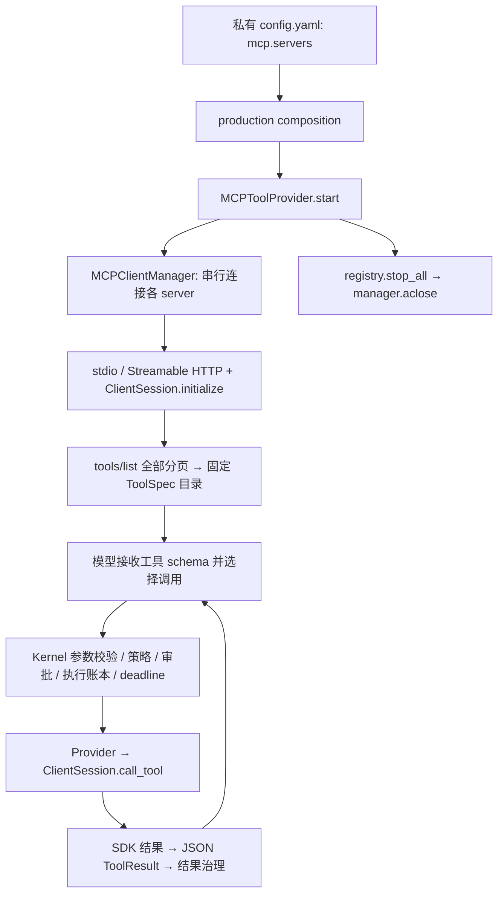

# MCP 流程与设计审查

审查日期：2026-11-02。初次审查之后已实施 P0：连接 owner、取消清理、argv、完整分页、
异常分类与结果未知账本。第 2 节保留改造前的复现与尚存问题，第 4 节包含后续目标设计；
最新使用行为见 [MCP 集成](mcp_integration.md)。验证使用本地服务和替身，没有调用用户的
远程 MCP 或修改私有配置。

结论：当前已有完整的 MCP tools 基本调用链，可以复用普通工具的审批、执行账本和
超时控制。P0 补齐了基础生命周期、全量发现和异常结果语义；动态目录、故障隔离和
结果呈现仍有改进空间，之后再增加按需连接、resources/prompts、OAuth 等能力。

## 1. 当前实际流程



| 环节 | 当前行为 | 本地源码入口 |
| --- | --- | --- |
| 配置 | 从 `~/.tsm-agt/config.yaml` 或显式配置路径读 `mcp.servers`；JSON helpers 不自动参与 | [mcp_configuration.py](../bootstrap/mcp_configuration.py)、[model_configuration.py](../bootstrap/model_configuration.py) |
| 组装 | 有启用项才注册 MCP provider；不改变主 Agent loop | [composition.py](../bootstrap/composition.py) |
| 生命周期 | 每个 server 一份缓存 client、一个初始化锁；SDK 上下文由长期 owner 持有；全部串行启动，失败关闭整体；无重连 | [ports/mcp.py](../ports/mcp.py) |
| 协议 | 官方 SDK 执行 initialize、tools/list、tools/call；端口只暴露工具和关闭 | [mcp_python_sdk_client.py](../adapters/mcp_python_sdk_client.py) |
| 工具目录 | 启动时固定；内部名 `mcp.<server>.<native-name>`；全部 R2 / 非幂等 / 不可并发 | [mcp_tool_provider.py](../adapters/mcp_tool_provider.py) |
| 模型与权限 | 模型选工具；普通 Kernel 校验、审批、执行记录与超时仍生效 | [kernel_tool.py](../core/kernel_tool.py)、[tool_concurrency.py](../core/tool_concurrency.py) |
| 回传 | `isError` 映射工具失败，SDK 对象转 JSON；没有 MCP 专用内容预算和媒体投影 | [mcp_tool_provider.py](../adapters/mcp_tool_provider.py) |

当前不是“所有调用没有超时”。Kernel 已有调用 deadline，并且非幂等工具超时会进入
`UNKNOWN_OUTCOME`。P0 已将相同结果语义覆盖到调用后断连、响应校验失败等路径；启动预算
和每服务器策略仍待后续实现。

## 2. 改造前复现与尚存问题

2.1–2.5 已由 P0 修复；2.6–2.7 仍是后续改进项。

### 2.1 SDK 上下文的生命周期依赖调用 Task

旧 `_session_client()` 在工厂调用者 Task 中进入 `AsyncExitStack`，返回 wrapper；
`aclose()` 在关闭者 Task 中直接退出该栈。使用当前安装的 `mcp==1.12.4`，真实 stdio
demo 在子 Task 创建后由父 Task 关闭，会报：

```text
RuntimeError: Attempted to exit cancel scope in a different task than it was entered in
```

现有同一 Task 往返测试通过，因此不能断言所有正常启动都会失败。但直接给当前工厂
套 `asyncio.gather()` 或独立 `wait_for()` 来增加并行/启动超时，会扩大这一问题。
**必须先让同一长期存活的 owner Task 完成 SDK 上下文的进入与退出。**

### 2.2 初始化取消被改成普通失败

旧 `_session_client()` 捕获 `BaseException`，清理后统一抛出 `RuntimeError`。
在初始化等待中取消 Task，实测收到 `RuntimeError`，而不是 `CancelledError`。
应清理后保留取消语义；普通失败保留可脱敏的原因链，不能统一丢弃原因。

### 2.3 工具列表只读第一页

旧 wrapper 调用一次 `session.list_tools()` 后只取 `.tools`，没有处理 `nextCursor`。
提供“第一页工具 + 下一页游标”的替身会话，实测只返回第一页且只请求一次。
工具多的服务会漏注册。应循环分页并对重复游标、重复名称和超大目录设界限。
[MCP tools 规范明确支持分页和目录变更通知](https://modelcontextprotocol.io/specification/2025-06-18/server/tools)。

### 2.4 单元素 command 被无条件当成 Python 脚本

旧实现将 `command=("npx",)` 转换为 `[Agent 的 Python, "npx"]`。
这不是 argv 的正常语义。应保留程序与参数；如需 Python 脚本便捷入口，应通过显式配置
表达。还应明确裸 `python` 重写为 Agent 解释器的兼容策略，保留显式绝对解释器路径。

### 2.5 断连没有接入结果未知语义

旧 Provider 将 RPC、连接、协议/结果校验等 `Exception` 统一转成 `MCP_TRANSPORT_ERROR`，
并标记 `retryable=True`。这不是已实现自动重试，但“could not run”的文案和错误分类
可能让后续模型误以为服务端未执行。旧 Kernel 只把非幂等工具的 `TIMEOUT` 升级为
`UNKNOWN_OUTCOME`；MCP 返回的上述错误会记成 `FAILED`。

应区分明确未发送、服务端明确返回失败、发送后断连/响应丢失/成功结果校验失败。
最后一类不能推断副作用没有发生。重连只恢复后续调用，不能自动重放结果未知的写操作。

### 2.6 部分合法原生名称无法进入模型请求

OpenAI-compatible adapter 通过替换 `.` / `__` 编码内部工具名，并限制 64 字符。
长 MCP server/tool 组合会导致整个请求构造失败；`mcp.demo.a__b` 与
`mcp.demo.a_u_b` 的编码相同。目前有冲突检测，行为是明确拒绝请求，不会静默调错工具。

应在模型适配层使用有长度上限的稳定别名和显式反向映射，并保留内部原名；设计还必须
覆盖历史消息中已撤销的工具和 checkpoint 恢复，不能只修改新工具广告。
入口：[OpenAI-compatible model](../adapters/openai_compatible/model.py)。

### 2.7 启动、目录与结果还有结构性限制

- 所有服务器串行启动，任意失败使整个 provider 失败；没有 required/optional 区分。
- `health()` 只反映 `_started`，不能表达单服务器断线、认证失效或正在重连。
- 工具目录仅启动时读取，不响应 `notifications/tools/list_changed`；没有工具过滤配置。
- `invoke()` 丢弃 `ToolInvocationContext`，`stop()` 丢弃关闭 deadline；没有 MCP 请求进度
  到 Runtime 事件的桥接。MCP progress 是调用进度，不等于模型文字的 token 流。
- schema、结构化结果、文本副本和媒体 base64 都直接进入 JSON；大结果会占用大量上下文。
  当前 SDK 会缓存发现到的 outputSchema 并校验成功结果，不能说完全没有输出校验；但端口
  没有保留这些元数据，也没有专用的媒体/大结果投影。
- 没有 resources/prompts 的 Agent 入口、OAuth 管理、roots 或 elicitation 桥接；这是功能
  覆盖范围，不要求为了协议齐全一次性全部实现。

## 3. 开源实现中值得借鉴的设计

比较使用以下固定提交，避免把不同时期的代码混为一谈。官方文档反映检索时的配置说明，
实现细节以链接的提交为准。

| 项目 | 提交 |
| --- | --- |
| Codex | `a09812981de703f18f38015cd5d500ab373f616c` |
| Hermes | `e8639fd4312e5102d6f10c76b56406cb01c19092` |
| DeepSeek Harness | `ce7073d51254c26cd63b22a60835b8f948deb447` |

### Codex：启动策略、请求取消、目录版本

官方配置区分 `startup_timeout_sec` / `tool_timeout_sec`，以及 `required` / 可选服务器；
同时提供工具允许/禁止列表、按工具审批和输出预算、OAuth 登录。
这说明“连接成功”之外还需要完整的使用策略。
[官方 MCP 文档](https://developers.openai.com/codex/mcp/)。

源码中会话层委托 MCP runtime 等待服务器、校验必需项，并传递启动取消信号；客户端
暴露分页游标和请求取消；传输层在收到工具列表变更通知时先增加目录 revision，避免后续
响应让推理继续时还看不到已发生的目录失效。
[会话 runtime](https://github.com/openai/codex/blob/a09812981de703f18f38015cd5d500ab373f616c/codex-rs/core/src/session/mcp_runtime.rs)、
[SDK 客户端](https://github.com/openai/codex/blob/a09812981de703f18f38015cd5d500ab373f616c/codex-rs/rmcp-client/src/rmcp_client.rs)、
[目录版本跟踪](https://github.com/openai/codex/blob/a09812981de703f18f38015cd5d500ab373f616c/codex-rs/rmcp-client/src/tool_list_changes.rs)。

对 tsm-agent 最直接的启发：启动策略显式化，目录有 revision，调用 cancellation 和宿主
生命周期贯通；不要只在 provider 中加一个刷新列表的函数。

### Hermes：长连接运维、按需发现、谨慎恢复

Hermes 为同步调用者提供独立 MCP loop 调度，并有连接生命周期、健康检查、重连和
profile 上下文传递。tsm-agent 本身已是异步框架，应学习所有权和关闭纪律，不必照搬
独立线程架构。
[loop 调度](https://github.com/NousResearch/hermes-agent/blob/e8639fd4312e5102d6f10c76b56406cb01c19092/tools/mcp_tool_loop.py)、
[生命周期](https://github.com/NousResearch/hermes-agent/blob/e8639fd4312e5102d6f10c76b56406cb01c19092/tools/mcp_tool_lifecycle.py)、
[健康恢复](https://github.com/NousResearch/hermes-agent/blob/e8639fd4312e5102d6f10c76b56406cb01c19092/tools/mcp_tool_health.py)。

其会话过期恢复区分只读工具与可能写入的工具：可能已经派发的写操作返回
`outcome_uncertain`，重建连接但不自动重放。结果渲染还处理结构化/文本重复和媒体内容。
这里的只读判断使用服务端 `readOnlyHint`，tsm-agent 应保留自己的本地授权策略，不能把
不可信服务端提示直接提升为免审批或并发权限。
[调用与结果处理](https://github.com/NousResearch/hermes-agent/blob/e8639fd4312e5102d6f10c76b56406cb01c19092/tools/mcp_tool_handlers.py)。

Hermes 的 lazy 模式使用持久化 schema cache，按连接配置指纹选择目录；未命中/失效时
仍需实际发现。它缓存的是工具说明，不是任意业务结果；其指纹字段也不应被原样当成
tsm-agent 多身份隔离方案。
[schema cache](https://github.com/NousResearch/hermes-agent/blob/e8639fd4312e5102d6f10c76b56406cb01c19092/tools/mcp_schema_cache.py)、
[配置参考](https://github.com/NousResearch/hermes-agent/blob/e8639fd4312e5102d6f10c76b56406cb01c19092/website/docs/reference/mcp-config-reference.md)。

### DeepSeek Harness：连接代次、关闭确认、目录同步串行化

连接 supervisor 通过 generation 区分新旧 client；目录同步使用 `syncChain` 串行执行。
旧 generation 的通知不能继续修改当前工具目录；无法确认失败连接已关闭时，会停止
重连以避免重叠子进程。调用向 SDK 传递执行 signal 和工具 timeout。
[connection.ts](https://github.com/deepseek-ai/deepseek-harness/blob/ce7073d51254c26cd63b22a60835b8f948deb447/packages/mcp/mcp-client/src/connection.ts)。

工具桥接先取回并构造下一代定义，再替换注册；输入/输出 schema 分别保留，图片按模型
能力和持久附件存储投影，而不是直接塞入 base64 JSON。
[tools.ts](https://github.com/deepseek-ai/deepseek-harness/blob/ce7073d51254c26cd63b22a60835b8f948deb447/packages/mcp/mcp-client/src/tools.ts)。

这适合用于 tsm-agent 的“连接换代 → 完整目录提交 → 下一次模型请求”边界，尤其需要
配合已有审批恢复和工具集 hash，而不是原地替换 `_tools` 就结束。

## 4. 适配本项目的目标设计

### 4.1 保留现有分层，明确连接 owner

P0 已在 SDK wrapper 实现最小 owner 生命周期；后续可按重连需求提取每服务器一个
`MCPConnectionSupervisor`。长期存活的 owner
coroutine 在同一 Task 中进入 transport/session、发布 ready、等待关闭信号，再退出。
调用者获得 proxy，不取得退出 SDK 栈的责任。启动超时和取消应通知 owner 并等待关闭
确认，不能简单把当前工厂放进短生命周期子 Task。

连接状态可从 `DISABLED / STARTING / READY / DEGRADED / AUTH_REQUIRED /
RECONNECTING / CLOSING / CLOSED` 开始；用 generation 防止旧通知污染新连接。
初始化/关闭都应有预算，关闭未确认前不启动下一代 stdio 进程。异步原生宿主无需新增线程。

Ports 层保留协议无关配置、目录快照和调用结果；SDK 细节、通知与 owner 留在 adapters。
Kernel 继续负责通用审批、deadline、账本、恢复和模型边界，不承担 MCP socket 管理。

### 4.2 完整目录与模型可见快照

- 分页取完 → 验证与过滤 → 生成稳定排序的完整快照 → 一次提交。中途失败不发布半份目录。
- 保留原生名、输入/输出 schema、服务端 annotations、能力与目录 revision；本地策略
  决定风险、幂等性、并发资格。annotations 是参考信息，不是自动授权。
- 收到 list_changed 只标记失效并安排一次合并刷新，避免每条通知都发起并行发现。
- 在模型采样/批次安全边界更新可见目录。当前 loop 只处理 `SKILL_CATALOG_CHANGED`，
  因此需增加通用目录变更机制，并协调 checkpoint 的 `toolset_hash` 和审批时的契约。
- 使用旧 schema 发出的待执行调用，若目标契约已变更，应返回目录变化并让模型重新决策，
  不能用旧审批执行新契约。单纯连接换代且契约相同，不必无条件重做审批。
- 模型 wire name 使用稳定短别名与反向表；调用记录始终保存真实内部名。别名算法版本和
  历史编码兼容应纳入恢复设计，不能把命名问题只放在 MCP 内部解决。

### 4.3 调用预算、派发阶段与恢复

配置应显式区分 startup timeout、tool timeout、shutdown timeout、HTTP transport timeout。
调用实际预算受 Kernel 总 deadline 约束；不得让新增 server timeout 悄悄绕过任务预算。
将取消、进度和必要的调用身份从 `ToolInvocationContext` 传到适配层。

| 证据 | 对模型和账本的语义 | 恢复 |
| --- | --- | --- |
| 能证明尚未发送 | 未执行的连接/配置错误 | 修复连接后可重新决策 |
| 收到合法工具失败响应 | `MCP_TOOL_ERROR`；不据此推断已回滚 | 模型读取失败内容后决定 |
| 已发送后响应丢失、断连或结果无法确认 | 可能写入时 `UNKNOWN_OUTCOME` | 先查询目标状态；不自动重放 |
| 本地策略确认只读且可重试 | 可受限重试的读取失败 | 有界重连/重试，受原 deadline 限制 |
| 用户取消 | 保留取消事实；已发送写操作仍可能结果未知 | 停止等待/请求取消，不宣称远端回滚 |

SDK 无法给出精确派发证据时，采用保守的不确定分类。P0 已让 Kernel 根据明确的
`UNKNOWN_OUTCOME` recovery kind 写账本，保留非幂等 `TIMEOUT` 的原有处理。
自动重连与自动重放必须是两个独立决策。

### 4.4 内容呈现与上下文开销

增加 MCP 专用 renderer：文本、structuredContent、图片、音频、resource link 分别处理。
保留 SDK 输出 schema 校验能力；对与 structuredContent 等价的文本副本可在模型投影中
去重，原始证据仍保留。媒体进入现有附件体系，模型不支持时给出可用引用和原因。

大结果设置显式预算，超出时返回摘要/片段、截断标记和可继续读取的 artifact 引用；
不要重新引入对所有 ToolResult 的无提示全局截断。原始大结果采用有存储配额和保留期的
artifact，checkpoint 保存引用，避免持久化层也被同一份 base64 放大。

工具过滤先做；server 很多时再考虑按需连接、schema cache 和工具搜索。缓存键至少覆盖
配置、工具策略、身份范围；credentials 只用安全的版本标识参与键，不能写入缓存正文。
schema 缓存只证明“曾发现过”，不能证明当前权限或在线状态；实际调用仍需连接并校验。

这与本地文件读取复用不同：不能仅因为 MCP 调用参数相同就复用业务结果。只读工具也
可能返回实时数据；只有明确的 TTL、版本或本地业务策略才能允许结果缓存。目录按语义
版本稳定排序，避免把时间戳/每次重连计数写入固定 prompt 段，可减少无意义的上下文变化。

### 4.5 可选协议能力

按实际服务器需求再增加 resources/list、templates/read 和 prompts/list/get；分页、
内容预算及身份隔离复用前述基础。prompts 是可选择的模板，不能自动变成系统级指令。
资源 URI 是服务器命名空间，不应按本机文件路径直接读取。

OAuth 提供显式登录/退出/重认证和私密凭据存储；roots 按授权工作区声明，但 roots 不是
操作系统沙箱。elicitation 接入已有用户交互接口；sampling 默认不开放，如实现需有
独立授权和模型预算，避免服务端绕过主任务消费模型额度。当前不需要为协议齐全抢先做完。

## 5. 实施顺序与验收

P0 之后的模块、配置、兼容和提交拆分见 [MCP P1 实施方案](mcp_p1_plan.md)。

| 阶段 | 改动范围 | 最小验收 |
| --- | --- | --- |
| P0：正确性基础（已实施） | owner 生命周期 → 取消/关闭 → argv → 全量分页 → 错误分类和结果未知接入 | 跨 Task 可关闭；取消保持取消；单元素可执行命令不改写；分页完整；响应丢失的写操作不重放且账本为未知 |
| P1：运行可靠性 | 启动/关闭预算、required/optional、受限并行启动、按服务器状态；工具过滤和稳定短别名；受控重连 | 一个可选服务失败不拖垮其他工具；必需服务失败清晰可见；无重叠子进程；长名/冲突名和恢复历史都可处理 |
| P1：目录和结果 | revision、通知刷新、安全模型边界、审批/恢复兼容；内容 renderer 与大结果引用 | 旧代通知无效；不发布半份目录；旧契约不能借旧审批执行；媒体与超限结果可追溯 |
| P2：规模与能力 | 按需连接/schema cache、工具搜索、资源/模板、OAuth/elicitation/roots | 缓存不跨身份复用；离线目录不伪装可用；可选能力有真实服务器用例 |

启动并发度应可配置并单独压测，不复用“工具批内最多 8 个”的含义；MCP 调用是否允许
并行还需要本地工具策略和服务器承载能力，不能凭 `readOnlyHint` 放开全部调用。
既有 YAML 的默认失败行为变更需要明确迁移策略，避免升级后必需服务故障被当成可选忽略。

测试应包含真实 stdio 和本地 Streamable HTTP，而不仅是 mock：慢初始化、初始化取消、
两个 Task 启停、重复关闭、分页循环、目录变化、子进程中途退出、只读重试、写入响应
丢失、超大/媒体输出，以及审批暂停后目录变化。优先覆盖对应阶段，不为尚未实现的
扩展预先堆积测试或引入第二套 Agent 执行循环。

## 6. 初次审查复现记录

- 现有 `tests/test_mcp_sdk_integration.py`：3 passed；覆盖真实 stdio 基本链路及审批回注。
- 初始化取消替身：观测到 `RuntimeError`，确认取消语义丢失。
- 分页替身：有 nextCursor 时仍只请求一页。
- argv 捕获：单元素 `npx` 被映射为 Python 执行 `npx`。
- 真实 stdio 跨 Task 关闭：复现 AnyIO cancel scope 所有权错误；使用独立子进程和限时回收。
- 名称编码：长名被拒绝，`a__b` / `a_u_b` 编码冲突；当前请求构造会拒绝冲突。

上述为修复前观察。P0 增加了以下实际回归入口：

- `tests/test_mcp_lifecycle.py`：Task 所有权、初始化取消、重复取消、关闭期间取消、
  失败清理中取消、分页游标/界限、argv 和初始化/关闭竞争。
- `tests/test_mcp_call_outcomes.py`：未发送证据、已派发异常、显式服务失败、序列化失败，
  以及关闭失败时继续清理其他服务器。
- `tests/test_mcp_sdk_integration.py`：真实 stdio 分页、跨 Task 启停、取消初始化后回收
  子进程；写入成功后断连/返回无效结构化结果时，验证账本为未知、暂停且恢复不重放。
- `tests/test_mcp_http_integration.py`：本机真实 SDK Streamable HTTP，有状态 SSE 与
  无状态 JSON 往返、跨 Task 和重复关闭。

P0 未增加自动重连；所有 MCP 工具仍采用非幂等保守策略。结果未知会进入已有人工现场
核对暂停流程，不能把这一状态当成服务端已回滚。P1/P2 的目录刷新、OAuth 等仍待实施。

P0/Kernel/审批/提示词专项回归 87 项通过，本地网络集成 8 项通过。全量受限环境初跑
1679 passed、9 failed、15 skipped；7 项监听端口失败在允许回环端口后复跑通过，另 2 项
连续性测试为容纳新增完整文案，将专用假模型窗口从 8K 调为 16K 后通过，运行时预算与
压缩边界未放宽。原先跳过的 HTTP 工程循环也在允许端口后通过。按测试身份合并最新
结果为 1689 passed、14 skipped；这是初跑与针对性复跑的汇总，非单次命令结果。
本地原始报告在 `.agent/evaluations/mcp-p0-20261102/`。
