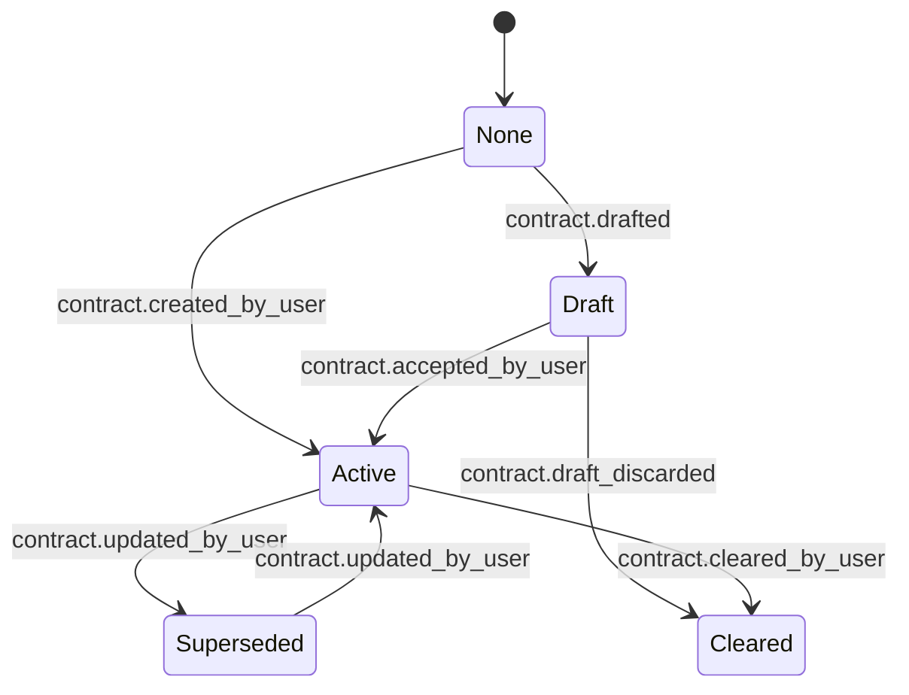
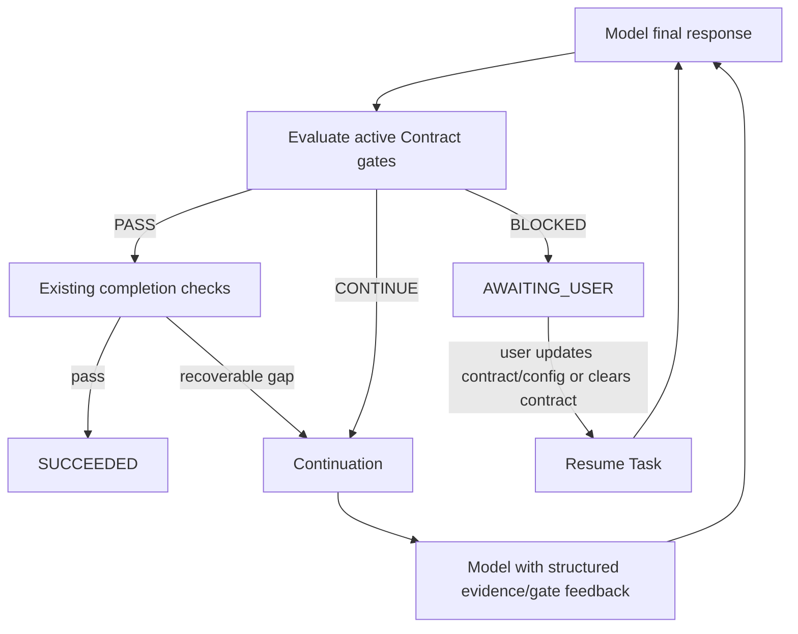

# Goal / Contract / Gate 闭环设计

> 本文替代“通用证据合同重构 Spec”作为后续实现依据。当前代码中的关键词触发、`SourceArtifact` 特判和泛化 `OBSERVE` satisfier 不作为目标架构。

## 1. 设计目标

将任务完成从“模型文本声称完成”或“出现某种 ToolEffect”改为：

```text
用户目标
→ 可选 Contract 草案
→ 用户接受的 Contract
→ 工具产生 Evidence
→ Gate 先判定
→ Loop 执行统一决策
```

Core 不认识 GitHub、网页、源码比较或任何业务关键词。新增能力只注册证据类型、Gate 或 Provider，不改 Loop。

## 2. 上游映射

| 上游做法 | 采用方式 | 不采用方式 |
|---|---|---|
| DeepSeek Harness `dsh-goal` | 持久状态、事件投影、状态与调度分离、blocked 是稳定结果 | 不额外创建与 Task 竞争的 Goal 生命周期 |
| Hermes `/goal` | 用户目标、可选 contract draft、用户可见/可编辑、deterministic gate 先于 judge | 不让自由文本 judge 单独成为硬完成依据 |
| Hermes quality gate | Gate 失败提供下一轮真实上下文、预算耗尽后暂停 | 不将 gate 失败伪装成模型或工具失败 |

## 3. 单一状态权威

`Task` 保持唯一执行生命周期：

```text
CREATED → … → EXECUTING → SUCCEEDED / FAILED / CANCELLED
                          ↘ AWAITING_USER
```

不新增平行 `GoalState`。用户目标继续由 `Task.goal` 表达；新增的 `TaskContract` 仅描述“何时允许完成”，不调度、不执行工具、不改变权限。

## 4. Contract Aggregate

Contract 是 task-scoped、事件化、版本化对象。

```python
class ContractAuthority(StrEnum):
    USER_EXPLICIT = "USER_EXPLICIT"
    MODEL_DRAFT = "MODEL_DRAFT"

class ContractPhase(StrEnum):
    DRAFT = "DRAFT"
    ACTIVE = "ACTIVE"
    SUPERSEDED = "SUPERSEDED"
    CLEARED = "CLEARED"

@dataclass(frozen=True)
class TaskContract:
    contract_id: str
    revision: int
    objective: str
    authority: ContractAuthority
    phase: ContractPhase
    guidance: Mapping[str, JsonValue]
    evidence_requirements: tuple[EvidenceRequirement, ...]
    deterministic_gates: tuple[GateDefinition, ...]
```

### Authority

| 来源 | phase | 是否阻断完成 |
|---|---|---|
| 用户/API 直接创建或更新 | ACTIVE | 是 |
| 模型 draft | DRAFT | 否 |
| 用户接受 draft | ACTIVE | 是 |
| 用户清除 | CLEARED | 否 |

模型不能将自己的 draft 直接变成 ACTIVE。Core 不从关键词推断或生成 ACTIVE Contract。

## 5. Contract 生命周期



每次写操作必须携带 `contract_id + expected_revision + command_id`：

- `expected_revision` 防止陈旧客户端覆盖；
- `command_id` 保证重试幂等；
- `request_hash` 必须包含完整合同内容；
- 事件 payload 保存完整 snapshot，以支持重放。

## 6. Evidence 与 Capability

工具声明可产出的 evidence capability；`ToolEffect` 只服务权限和副作用，不参与合同满足。

```python
@dataclass(frozen=True)
class EvidenceFact:
    fact_id: str
    kind: str
    execution_ref: str
    attributes: Mapping[str, JsonValue]
    provenance: Mapping[str, JsonValue]
    complete: bool
```

示例：

| 工具结果 | evidence kind | 是否可做源码实现结论 |
|---|---|---|
| 网页搜索结果 | `web.discovery` | 否 |
| 已读取网页 | `web.document` | 仅文档结论 |
| 固定 revision 的代码文件 | `source.artifact` | 是 |
| 本地读取文件 | `workspace.artifact` | 是 |
| 成功验证命令 | `command.verification` | 是 |

Provider 负责 `ToolResult → EvidenceFact[]`；Gate 负责需求匹配；Loop 不理解具体 evidence kind。

## 7. Gate 协议

```python
class GateResolution(StrEnum):
    PASS = "PASS"
    CONTINUE = "CONTINUE"
    BLOCKED = "BLOCKED"

@dataclass(frozen=True)
class GateDecision:
    resolution: GateResolution
    missing_requirement_ids: tuple[str, ...]
    required_capability_ids: tuple[str, ...]
    reason_code: str
    detail: str
    recovery_actions: tuple[RecoveryAction, ...]
```

### 执行顺序

```text
候选 final response
→ deterministic Contract Gate
→ 现有 mutation / verification completion checks
→ 可选 LLM acceptance/judge
→ final response
```

### 语义

| 条件 | 决策 | Task 行为 |
|---|---|---|
| 无 ACTIVE Contract，或所有 requirement 满足 | PASS | 继续已有完成流程 |
| 缺 requirement，且精确 satisfier capability 可见 | CONTINUE | 注入 continuation，只列缺 requirement 和可用 capability |
| 缺 requirement，且 satisfier capability 不可见 | BLOCKED | 转 `AWAITING_USER`，创建结构化 clarification |
| deterministic gate 命令失败且仍可重试 | CONTINUE | 输出 gate 结果，受预算限制 |
| deterministic gate 不可运行、配置缺失或预算耗尽 | BLOCKED | 转 `AWAITING_USER`，说明恢复动作 |

`BLOCKED` 不进入 `FAILED`。只有工具未知结果、安全拒绝、不可恢复基础设施错误才可失败。

## 8. Loop 状态机



协议参数错误不走 Gate：Runtime 写入结构化、模型可见的 rejected-tool result，保留调用 id 与错误字段；下一轮允许模型修正。不得留下孤立 assistant ToolCall。

## 9. API 与 UI

### API

```text
POST   /tasks/{taskId}/contracts/drafts
GET    /tasks/{taskId}/contract
POST   /tasks/{taskId}/contract/accept
PUT    /tasks/{taskId}/contract
DELETE /tasks/{taskId}/contract
POST   /tasks/{taskId}/resume
```

`POST /tasks` 仍可接受用户显式 Contract，作为创建 ACTIVE Contract 的快捷入口。

### UI

- 普通 task 不展示合同配置。
- 模型 draft 后展示 Contract card：`接受`、`编辑`、`忽略`。
- `AWAITING_USER` 显示 blocked reason、缺失 requirement、可用 recovery action。
- 用户启用公开 GitHub source capability 后可点击恢复；私有仓库配置仍由部署/管理员完成。

## 10. 已确认的产品决策

### 10.1 自动合同草案

产品在识别到需要长任务完成标准时可以自动生成 `MODEL_DRAFT`，但草案不阻断完成。UI 必须显示 Contract Card，用户可选择：

```text
接受合同 / 编辑 / 按普通任务执行
```

只有用户接受后，草案才创建 `USER_EXPLICIT + ACTIVE` revision。

### 10.2 编辑 ACTIVE Contract

ACTIVE Contract 可以再次编辑，但用户不接触内部 JSON。Card 展示并允许编辑：

```text
目标 / 验证方式 / 范围 / 限制 / stop_when
```

模型可根据自然语言生成合同修改草案和 diff；用户必须点击“接受修改”。接受后创建新 revision，旧 revision 标记 `SUPERSEDED`。

编辑在安全边界生效：当前 model call 或 tool batch 完成后，下一轮读取新 revision。运行中调用不强行中断。

### 10.3 BLOCKED 交互

`BLOCKED` 复用现有 clarification 机制，不新增第二套等待状态。clarification payload 必须包含：

```text
blocked reason
缺失 requirement
可用 recovery actions
当前 contract revision
```

用户可在 clarification 中选择启用能力、提供来源、接受合同修改草案、清除合同或取消任务。