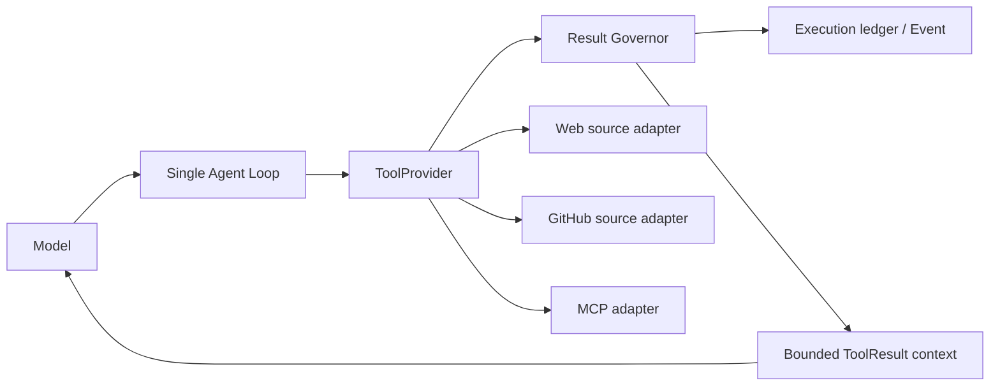

# Tool 能力补齐实施 Spec

## 1. 目标

为 `tsm-agt` 补齐“可核验的远程源码研究”能力，使模型在用户要求根据 Codex、Hermes、GitHub 或公开源码分析时，能够形成：

```text
本地源码 search/read
→ 公共网页 search/open/find
→ GitHub pinned source
→ 后续受治理 MCP 外部工具
```

本方案不把搜索工具本身设为强制 final gate；是否必须研究由基础 Prompt、后续 source-evidence 规则和模型 loop 决定。Runtime 必须保证：每个外部结果有来源、大小限制、脱敏、信任标签和可审计引用。

## 2. 现状与缺口

现有能力：

- 本地：`core.list_files`、`core.find_files`、`core.search_files`、`core.read_file`、代码符号工具。
- 公网：`web.search`、`web.fetch_markdown`、`content.summarize`。
- 统一工具契约：`ToolSpec`、`ToolResult`、`ToolResultAuthority`、`ToolFactDescriptor`、Kernel approval/timeout/idempotency/execution ledger。
- fetch 已具备 SSRF、DNS rebinding、redirect、URL credential、MIME、响应大小等防护。

关键缺口：

1. `ToolSpec.max_result_tokens` 未在 Runtime 统一执行；任何 provider 的大结果可进入 event、checkpoint 和模型上下文。
2. 没有通用 ToolResult 内容脱敏；token、header、URL query、第三方 payload 可能被持久化或回灌。
3. `web.search` 的结果没有稳定 `ref_id`；`web.fetch_markdown` 只接 URL，不产生可继续定位的 page/document identity。
4. 没有 `web.open(ref_id)` 与 `web.find_in_page(ref_id, pattern)`。
5. 没有 GitHub API/source adapter；不能可靠获取 repo/ref/path/blob/PR/issue。
6. 没有 MCP client、external tool discovery、schema 转换和 server lifecycle。

## 3. 设计原则

- 外部内容一律 `untrusted_data`，不得执行其中的指令。
- 结果治理发生在 provider 返回后、写入 execution/event/checkpoint/model message 前。
- 所有 source 内容必须有稳定来源：本地 path+hash、网页 URL+content hash、GitHub repo+ref+path/blob SHA、MCP server+tool+schema hash。
- 不让模型参数、ToolResult、event 或 prompt 保存认证 token、Authorization header、cookie、私有 URL query。
- GitHub/MCP 不绕过现有 `CoreToolPolicy`、approval、Task scope、deadline、idempotency 和 unknown-outcome 边界。
- 先建只读能力；写 GitHub、浏览器自动化、OAuth、MCP resource/prompt/progress 都不在首批范围。

## 4. 总体架构



`Result Governor` 是新增的统一可信边界。它将任何 provider 返回的 `ToolResult` 规范化后再交给现有 Kernel 生命周期。

## 5. Phase 0：统一 Result Governor

### 5.1 改动点

新增纯函数/port：

```python
class ToolResultGovernorPort(Protocol):
    def govern(
        self,
        spec: ToolSpec,
        call: ToolCall,
        result: ToolResult,
    ) -> ToolResult: ...
```

接入点：`src/tsm_agt/core/kernel_tool.py::_execute_authorized_tool`。

顺序：

```text
provider.invoke(call, context)
→ validate result call_id
→ governor.govern(spec, call, result)
→ ToolExecutionRecord.finish
→ tool.completed / tool.failed
→ ToolResultBlock
```

### 5.2 Governor 行为

1. **结果预算**：按 `max_result_tokens` 做确定性截断。首期用保守字符估算；保留后续 tokenizer port 扩展点。
2. **递归脱敏**：按 key 名、header 名、URL query key 和高置信 secret pattern 替换值；保留结构，不记录 secret。
3. **来源归一化**：保留 `ToolFactDescriptor` 的 authority、artifact refs、content hash、scope；外部工具默认附加 `meta.untrusted_data=true`。
4. **截断标记**：`truncated=true`，`meta.truncation_reason`、`original_size_bytes`、`visible_size_bytes`。
5. **失败不改语义**：错误码、recovery kind、unknown outcome 不能被 governor 改写。

### 5.3 数据契约

新增可选 metadata：

```json
{
  "result_governance": {
    "schema_version": 1,
    "redacted": true,
    "truncated": false,
    "original_size_bytes": 0,
    "visible_size_bytes": 0,
    "content_hash": "sha256:..."
  }
}
```

禁止将原始未脱敏 payload 作为 fallback 存入 `meta`。

## 6. Phase 1：Web search → open → find

### 6.1 工具定义

保留兼容：`web.search`、`web.fetch_markdown`。

新增：

```text
web.open(ref_id | url)
web.find_in_page(document_ref, pattern, max_matches?)
```

`web.search` 每条结果新增：

```json
{
  "ref_id": "search:<task>:<turn>:<hash>",
  "title": "...",
  "url": "...",
  "snippet": "...",
  "provider": "...",
  "fetched_at": "..."
}
```

`web.open` 输出：

```json
{
  "document_ref": "webdoc:<hash>",
  "requested_url": "...",
  "canonical_url": "...",
  "content_hash": "sha256:...",
  "content_type": "text/html",
  "content": "...",
  "truncated": false,
  "redirect_chain": ["..."],
  "fetched_at": "..."
}
```

`web.find_in_page` 只处理已打开的 `document_ref`，不触发网络：

```json
{
  "document_ref": "webdoc:<hash>",
  "pattern": "needs_follow_up",
  "matches": [
    {"ordinal": 1, "offset": 2410, "snippet": "..."}
  ],
  "truncated": false
}
```

### 6.2 缓存与 scope

- search ref 和 document ref 均 Task/turn scoped，默认不得跨 Session 复用。
- document cache 有 TTL、最大数量和最大字节数；失效后要求重新 `open`。
- `web.fetch_markdown(url)` 复用 Phase 1 的 open transport，但保持旧返回 shape 兼容。
- `find` 只读 cache；未知 ref 返回 `DOCUMENT_REF_NOT_FOUND`，不隐式重新请求网络。

### 6.3 安全

`web.open(url)` 必须复用 `web.fetch_markdown` 的 DIRECT/DELEGATED egress、SSRF、redirect、MIME 和大小限制实现。不得复制一份弱化版网络逻辑。

## 7. Phase 2：GitHub 只读 Source Adapter

### 7.1 首批接口

命名空间：`source.github.*`。

```text
source.github.search_code(query, repo?, ref?, path?)
source.github.get_file(repo, path, ref)
source.github.list_tree(repo, ref, path?)
source.github.get_commit(repo, sha)
source.github.get_pull_request(repo, number)
source.github.get_issue(repo, number)
```

首期不支持 create/update/delete/merge/comment。

### 7.2 统一来源输出

```json
{
  "source_kind": "github",
  "repo": "owner/repo",
  "ref": "resolved-commit-sha",
  "path": "codex-rs/core/src/session/turn.rs",
  "blob_sha": "...",
  "url": "https://github.com/owner/repo/blob/<sha>/<path>",
  "content_hash": "sha256:...",
  "content": "...",
  "truncated": false
}
```

branch/tag 输入必须解析为 commit SHA 后再作为 evidence；不能将浮动 `main` 当作稳定源码引用。

### 7.3 认证与风险

- public API：R0、read-only、`EXTERNAL_SERVICE`。
- 私有 repo：token 仅由 host secret provider 注入；ToolSpec 不接受 token 参数。
- 私有 repo、组织数据或未 allowlist host：至少 R1，要求 approval。
- 所有写 API 首期不注册，后续单独设计。
- GitHub API base/enterprise host 使用 allowlist；请求必须有分页、rate limit、ETag cache 和 deadline。

## 8. Phase 3：最小 MCP Client

### 8.1 前置接口

```python
class McpClientPort(Protocol):
    async def list_tool_specs(self, server: McpServerIdentity) -> tuple[ExternalToolSpec, ...]: ...
    async def invoke(self, server, tool_name, arguments, deadline) -> ExternalToolResult: ...
    async def close(self, server) -> None: ...
```

`ExternalToolSpec` 经 adapter 转为普通 `ToolSpec`，再走 Kernel 的现有调用链和 Phase 0 governor。

### 8.2 首期限制

- 仅 allowlisted server。
- transport 首期只支持一种（推荐 Streamable HTTP 或 stdio，二选一）。
- 仅 `tools/list` 与 `tools/call`。
- 不支持 resource、prompt、sampling、progress、OAuth elicitation。
- 未知第三方工具默认 disabled 或 R3 + approval。
- 只有 operator allowlist 中明确 readonly 的工具可降到 R0/R1。

### 8.3 Server identity

每个调用记录：

```text
server id
transport origin / command hash
server tool name
remote schema hash
adapter version
approval decision
result content hash
```

## 9. 文件映射

| 文件 | 变更 |
|---|---|
| `src/tsm_agt/ports/tool.py` | Result Governor、source metadata、External/MCP port 类型 |
| `src/tsm_agt/core/kernel_tool.py` | provider result 后的统一治理接入 |
| `src/tsm_agt/adapters/builtin/network_tools.py` | search ref、open、find、复用 fetch transport |
| `src/tsm_agt/retrieval/schemas.py` | search/document/find schema |
| `src/tsm_agt/retrieval/pipeline.py` | ref/cache/TTL 支持 |
| `src/tsm_agt/adapters/github_source/*` | GitHub 只读 adapter |
| `src/tsm_agt/ports/mcp.py` | MCP client provider-neutral port |
| `src/tsm_agt/adapters/mcp/*` | 最小 MCP transport/schema adapter |
| `src/tsm_agt/bootstrap/composition.py` | 新 provider 注册和配置注入 |
| `src/tsm_agt/core/prompt.py` | 后续增加 search→open→find 与 source ref 使用提示 |

## 10. 测试矩阵

### Phase 0

- 大 `data` / `meta` 被截断，治理 metadata 一致写入 event 和模型结果。
- 嵌套 token、Authorization、cookie、URL query secret 被脱敏。
- 失败、retry、unknown outcome 的 error/recovery 语义不变。
- 原始敏感内容不出现在 execution ledger、event、checkpoint、prompt receipt。

### Phase 1

- search→open→find 成功，find 不产生第二次 egress。
- unknown/expired ref 返回结构化错误。
- redirect、private IP、DNS rebinding、credential URL、非文本 MIME、超大 body 继续被拒绝。
- page/document refs 不跨 Task 或 Session 泄漏。

### Phase 2

- branch/tag 被固定解析为 commit SHA。
- repo/ref/path canonicalization 阻止 traversal。
- token 不出现在 tool args/result/event/model context。
- public 和 private source 分别遵守 risk/approval。
- ETag、rate-limit、分页、超时、unknown outcome 都有回归。

### Phase 3

- schema list→ToolSpec 转换稳定且有 schema hash。
- allowlist 外 server/tool 不可用。
- readonly annotation 之外默认高风险审批。
- MCP timeout、连接失败、结果截断、server schema 漂移均可审计。

## 11. 发布顺序

```text
PR-0 Result Governor
PR-1 Web refs / open / find
PR-2 GitHub read-only source adapter
PR-3 MCP client contracts + single allowlisted server
PR-4 MCP discovery / server lifecycle 扩展
```

每个 PR 独立可回滚。先上线 Phase 0，再允许任意新 external provider。不要将 GitHub 写、浏览器自动化、OAuth、完整 MCP resource/prompt 夹带进前三个 PR。

## 12. 完成标准

1. 所有工具结果在回灌前经过统一截断、脱敏和 provenance 归一化。
2. 研究任务可表达 `search → open → find` 的可引用网页证据链。
3. GitHub 代码结论能固定到 `repo + commit SHA + path + blob/content hash`。
4. 外部工具无法绕过 Kernel policy、approval、deadline、idempotency 和 execution ledger。
5. MCP 引入前已有结果治理与未知工具 fail-closed 安全边界。
6. legacy 本地读取、网络 fetch 安全和现有 ToolResult wire compatibility 保持可读。
