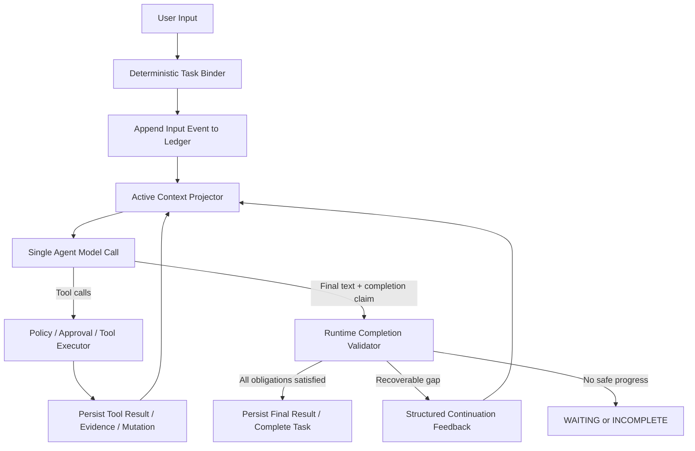

# tsm-agt 单 Agent Loop 重构实施 Spec

## 1. 背景与问题

当前执行链路为：

```text
用户输入
→ Session Router 模型
→ TaskSpec Planner 模型
→ Agent Execution 模型
→ 工具循环
```

同一用户意图会在多个模型调用之间被重新解释，并且不同层看到不同会话窗口。已观测到的故障包括：

- `task-444...`：一次字面量空搜索后直接给出泛化 CSS，没有继续定位代码；
- `task-1083...`：旧 Session 的泛化 CSS 回答进入上下文，Planner 将 UI 修改请求降级成纯解释；
- `task-17390...`：含 task-id 的运行时诊断请求被规划成 `ANSWER`，没有读取 runtime ledger；
- 初始目标在多轮后可能退出 Router 的最近消息窗口，而最近 assistant 回答反而成为强语义锚点。

根因不是单一搜索工具能力不足，而是模型前置 Router / Planner 提前决定“是否需要行动”，使执行循环失去从工具事实纠正意图的机会。

## 2. 研究结论与设计原则

### 2.1 Codex 可借鉴点

Codex 使用单一模型工具循环。完整 rollout 可持久化；模型只看到由 `ContextManager` 管理的活动历史。工具结果作为历史项进入下一次采样；上下文超预算时使用 compacted replacement history 替换旧活跃历史，并通过差分 world state 注入环境、权限、工具和模式状态。

### 2.2 Hermes 可借鉴点

Hermes 区分完整 Session 存储与当前 active context。压缩降低 active context，不删除完整 Session；跨 Session 使用有上限的 persistent memory 与按需 Session search 补回信息，而不是无界重放历史。

### 2.3 核心原则

1. 一个用户输入只进入一个 Agent loop；不再先经过 Router 模型和 Planner 模型。
2. 模型决定具体工具策略；Runtime 不替模型选择搜索词、文件或命令。
3. Runtime 校验事实、权限和结束条件；不能接受没有 durable evidence 的完成声称。
4. 完整历史与模型活动上下文分离；历史可审计，不等于每轮都注入 prompt。
5. 当前 Task 的 root goal、开放义务和已接受证据永不依赖原始聊天消息存活。
6. 旧 assistant 文本不是事实；除近期局部对话外，长期上下文只投影结构化事实与引用。

## 3. 目标与非目标

### 3.1 目标

- 移除新任务的模型前置 `Session Router` 与 `TaskSpec Planner` 调用。
- 新建单一 Agent loop，支持直接回答、搜索、runtime 诊断、修改和验证。
- 为每个 Task 持久保存 immutable root goal、当前输入、义务、证据、工具执行和 mutation。
- 使用受限的结构化 Active Context Projection，避免初始目标丢失和旧回答锚定。
- 对 task-id/session-id/trace-id 提供只读 inspection 工具。
- 保持历史 Task/Session 的读取、恢复、展示、审批和回滚兼容。

### 3.2 非目标

- 不替换底层 SQLite event store。
- 不以 embedding/向量搜索替代代码搜索。
- 不移除审批、Sandbox、Mutation Journal、Working Memory、Todo 或 Web 面板。
- 不要求每个普通知识问答调用工具。
- 不自动迁移或重跑已结束的历史 Task。

## 4. 目标架构



### 4.1 保留的 Runtime 实体

| 实体 | 新职责 |
|---|---|
| `Session` | 输入序列、Task index、用户选择和 UI 会话容器；不再由模型做路由判断。 |
| `Task` | Durable work unit：root goal、状态、义务、证据、工具和 mutation 的权威容器。 |
| `AgentTurn` | 一个用户输入驱动的单模型工具循环及其 checkpoint。 |
| `Working Memory` / Todo | 模型维护的执行辅助状态；不能代替 Task 合同。 |
| Mutation Journal / Approval | 继续作为工作区写操作的权威审计与安全边界。 |

### 4.2 移除或降级的模型前置组件

| 当前组件 | 目标状态 |
|---|---|
| `SessionInputResolverPort` | 新路径不调用；保留 legacy-read/feature flag 兼容。 |
| `TaskSpecPlannerPort` | 新路径不调用；Task 合同由 Runtime 事件和单 loop intent 建立。 |
| `TaskOutcomeKind.ANSWER` | 不再为新 Task 写入；仅 legacy 反序列化与 UI 展示。 |
| `ANSWER` route | 不再作为模型前置分流；直接文本只是 Agent loop 的一种终止输出。 |

## 5. 确定性 Task Binder

Binder 不使用模型，只根据显式标识和 Session 状态绑定输入：

```text
1. 输入显式包含有效 task-id
   → 绑定指定 Task；无权限或不存在则结构化报错。

2. 用户使用 /new
   → 创建独立 Task。

3. 当前 workspace 有一个 EXECUTING / WAITING Task
   → 输入作为该 Task 的 continuation / steering。

4. 没有活动 Task
   → 创建新 Task。

5. 多个候选且无显式引用
   → Runtime 请求用户选择；不让模型猜测 referent。
```

输出是 `TaskBindingDecision`，而不是自然语言目标：

```json
{
  "task_id": "task-...",
  "binding": "EXPLICIT_REFERENCE | ACTIVE_CONTINUATION | NEW | USER_SELECTED",
  "current_input_event_ref": "session-event:...",
  "source_task_id": null,
  "requires_runtime_inspection": false
}
```

## 6. 单 Agent Loop

### 6.1 首次模型响应中的 intent 声明

不新增独立 Intent Model。单 loop 的第一个模型响应必须通过结构化 `core.turn_intent` 声明本轮预计工作；该调用属于同一个模型循环，不是 Planner。

```json
{
  "intent": "DIRECT_RESPONSE | INVESTIGATE | MODIFY | VERIFY | INSPECT_RUNTIME",
  "expected_effects": ["observe", "mutate", "execute"],
  "fact_dependencies": [
    {"kind": "workspace_source", "reference": "src/..."},
    {"kind": "runtime_task", "reference": "task-..."}
  ],
  "summary": "..."
}
```

- 通用知识问答可声明 `DIRECT_RESPONSE`，`expected_effects=[]`。
- 模型决定精确工具和顺序，例如先 `search_files`、再 `read_file`、再 `apply_patch`。
- Runtime 只验证声明格式、可用能力、权限以及与显式硬锚点是否冲突。
- intent 可在同一 turn 内升级，例如 `INVESTIGATE → MODIFY`；升级必须持久化事件。

### 6.2 循环伪代码

```python
async def run_turn(task_id: str, input_event: InputEvent) -> TurnResult:
    checkpoint = load_or_create_checkpoint(task_id, input_event)

    while checkpoint.has_budget:
        context = project_active_context(task_id, checkpoint)
        response = await model.complete(context, visible_tools(task_id))
        persist_model_response(response)

        if response.tool_calls:
            for call in response.tool_calls:
                decision = validate_tool_call(task_id, call)
                result = await execute_or_request_approval(decision)
                persist_tool_result(task_id, call, result)
            checkpoint = refresh_checkpoint(task_id)
            continue

        claim = parse_final_claim(response)
        gaps = derive_completion_gaps(task_id, claim)
        if not gaps:
            return persist_completed_turn(task_id, response)
        if gaps.recoverable and checkpoint.has_budget:
            persist_continuation_feedback(task_id, gaps)
            checkpoint = refresh_checkpoint(task_id)
            continue
        return persist_incomplete_boundary(task_id, response, gaps)
```

## 7. Task 合同与完成校验

### 7.1 不再使用 ANSWER outcome

最终 assistant 文本由 `llm.completed` / `turn.completed` 表达，不再作为 Task outcome。

新 Task 合同由四类数据形成：

1. 用户输入中的显式硬锚点；
2. 同一模型循环声明的 `turn_intent`；
3. 实际已执行且成功持久化的工具事实；
4. Runtime 安全和审批规则。

### 7.2 硬锚点校验

| 用户/intent 信号 | Runtime 最低义务 |
|---|---|
| `task-...` / session-id / trace-id | 成功的 `runtime.inspect_*` evidence。 |
| 明确文件路径、符号、栈帧、当前代码行为 | 对应的 `observe` evidence。 |
| 模型 intent 声明 `MODIFY` | 净生效 mutation。 |
| 模型 intent 声明 `VERIFY` | 成功 execute/verification evidence。 |
| 普通知识解释 | 无强制 effect。 |

模型决定意图和工具；Runtime 仅阻止“已声明或明显锚定为事实工作，却没有事实”的提前完成。

### 7.3 Completion Claim

模型生成最终文本时同时提交：

```json
{
  "summary": "...",
  "evidence_refs": ["tool_call:..."],
  "claimed_effects": ["observe", "mutate"],
  "remaining_work": []
}
```

Runtime 从 ledger 计算而不信任 `claimed_effects`：

- `observe`：存在匹配的成功 inspection / source evidence；
- `mutate`：Mutation Journal 有净生效工作区变化；
- `execute`：存在成功、匹配的执行/验证记录；
- `runtime inspection`：查询的 task/session/event ref 与用户指定 ID 匹配。

缺口仍可恢复时，Runtime 追加结构化 continuation feedback；预算耗尽或无法安全继续时写入 `WAITING` / `INCOMPLETE`，禁止 `SUCCEEDED`。

## 8. Active Context Projection

### 8.1 权威结构

```json
{
  "authority": {
    "current_input": "AUTHORITATIVE",
    "task_root_goal": "AUTHORITATIVE",
    "open_obligations": "AUTHORITATIVE",
    "accepted_evidence": "AUTHORITATIVE",
    "tool_recovery": "AUTHORITATIVE",
    "recent_dialogue": "NON_AUTHORITATIVE",
    "historical_task_summaries": "NON_AUTHORITATIVE",
    "assistant_prior_text": "NON_AUTHORITATIVE"
  }
}
```

### 8.2 必须保留的数据

无论消息压缩多少次，以下字段必须在每次模型调用出现：

```text
- 当前输入原文
- 当前 Task 的 immutable root_goal
- 当前 Task state
- 当前 turn intent
- 开放义务与 completion gaps
- 已接受 evidence 的简洁结构化摘要和稳定引用
- 当前可用工具、审批状态、workspace identity
```

### 8.3 非权威历史

- `recent_dialogue`：最多 2~4 个必要 exchange；仅解释“继续/它/刚才”。
- `historical_task_summaries`：task-id、goal、状态、净 mutation、开放义务、evidence refs；不默认含 assistant 正文。
- `assistant_prior_text`：仅在紧邻 exchange 中保留，不能定义 root goal、约束或验收。
- 用户提及旧 task-id / 旧目标时，模型调用 inspection/retrieval 工具取得结构事实，不扩大全量消息窗口。

## 9. 压缩与恢复

### 9.1 三层数据

```text
Durable Ledger
  全量 Session / Task / Tool / Approval / Mutation / Event。

Active Context
  当前 root goal、开放义务、已接受事实、少量局部对话。

Compacted Replacement History
  压缩后的近期历史替代旧 active history；不删除 Durable Ledger。
```

### 9.2 Compact 摘要规则

压缩摘要必须保留：

- root goal 和明确用户决策；
- 当前 intent 和开放义务；
- accepted evidence 的事实摘要、稳定引用、路径/hash；
- 未解决 recovery action；
- pending approval / user choice。

压缩摘要不得将旧 assistant 推测、未成功工具调用结论、未经 Runtime 验证的“已完成”声称升级为事实。

每次 compact 生成 `context.compacted` 事件，保存 replacement projection、被覆盖的 event range、projection hash 和 root-goal hash。恢复从最近 compact checkpoint 加幸存事件重放；不重新注入完整历史。

## 10. Runtime Inspection 工具

新增只读、受权限和范围限制的工具：

| 工具 | 用途 |
|---|---|
| `runtime.inspect_task(task_id)` | Task root goal、状态、intent、义务、mutation、摘要、evidence refs。 |
| `runtime.list_task_events(task_id, cursor, limit)` | 有界事件查询，不返回无界原始文本。 |
| `runtime.inspect_session(session_id)` | Session task index、活动 task、结构化摘要。 |
| `runtime.search_history(query, scope)` | 按 task-id/用户消息/摘要检索 durable ledger，返回引用和短摘要。 |

数据库仍是 adapter 内部实现细节，不应让模型猜测 `.agent/runtime.db` 路径或 schema。

## 11. 事件与兼容模型

新增事件：

```text
turn.intent_declared
turn.intent_updated
turn.completion_claimed
turn.completion_rejected
turn.incomplete_boundary
context.compacted
context.replacement_installed
```

兼容规则：

- 旧 `task_spec.revised`、`task_execution_focus.changed`、`session.input_resolved` 继续可读和展示。
- 旧 `TaskOutcomeKind.ANSWER` 保留 enum 反序列化，但新路径不再写入。
- 旧 Router/Planner 仅在 `legacy_orchestration=true` feature flag 下继续调用。
- 新 Task 可与旧 runtime.db 并存；projection 按 event 类型选择新旧读取逻辑。
- 旧已完成 Task 不回溯重判，也不自动改变状态。

## 12. 分阶段实施计划

### Phase 0：基线与观测

- 为当前 Router/Planner/Execution 增加统一 trace correlation。
- 固化 `task-444`、`task-1083`、`task-17390` 的回归 fixture。
- 输出旧路径各层 prompt projection 的 hash、authority 和可见 event refs。

### Phase 1：活动上下文投影

- 引入 `ActiveContextProjection` 与 `TaskRootGoal`。
- 执行模型优先消费该投影；旧 Session projection 作为 background。
- 建立 compact replacement projection 与恢复测试。

### Phase 2：确定性 Binder

- 新增 `TaskBindingDecision` 和显式 task-id 解析。
- Web/SDK 输入走 binder；Router 模型仍可由 feature flag 回退。
- 歧义场景改为用户选择，不产生模型猜测路由。

### Phase 3：单 Agent Loop 与 Intent

- 引入 `core.turn_intent`、`turn.intent_declared`、`CompletionClaim`。
- 新任务关闭 Planner 调用；Todo/Working Memory 继续可用。
- 新路径不再生成 `ANSWER` outcome。

### Phase 4：运行时诊断与完成校验

- 交付 runtime inspection tools。
- 将 explicit anchor、intent、ledger fact 接入 completion gaps。
- 将 `mutate/execute` delivery gate 与 runtime inspection evidence gate 统一到 completion validator。

### Phase 5：UI、迁移与删除

- Web 面板显示 binding、intent、obligations、accepted evidence、incomplete boundary。
- 默认启用新 loop，保留 legacy feature flag 一个发布周期。
- 迁移完成后删除 Router/Planner 的新任务写路径；保留 legacy event reader。

每个 Phase 应独立可发布；不要将超过约 500 行的逻辑改动混入同一变更。

## 13. 验收场景

| 场景 | 验收 |
|---|---|
| 通用知识解释 | 单 loop 直接文本完成，不要求工具。 |
| 代码定位 | 模型自行 search/read；无 evidence 时 final claim 被拒绝。 |
| task-id 诊断 | `runtime.inspect_task` evidence 是完成前置条件。 |
| UI 修改 | intent 升级为 MODIFY 后，无净 mutation 不得成功。 |
| 修改后验证 | intent 含 VERIFY 时，无成功 execute 不得成功。 |
| 20 轮后继续初始任务 | root goal 仍在 authoritative projection，历史 assistant 文本不改写目标。 |
| 显式旧 task-id | 精确 inspection，不依赖最近消息窗口。 |
| 多次 compaction 后恢复 | 义务、root goal、pending approval、accepted evidence 和工具协议不丢失。 |
| 旧 Session 恢复 | legacy task/spec/event 可展示且不反序列化失败。 |
| 模型坚持泛化回答 | Runtime 写 `INCOMPLETE` / `WAITING`，绝不伪造 `SUCCEEDED`。 |

## 14. 关键不变量

```text
INV-SL1  每个活跃 Task 的 root goal 永久可投影。
INV-SL2  旧 assistant 自然语言不得自动成为新 Task authority。
INV-SL3  Tool call、result、approval、mutation 必须先持久化，后进入下一次模型调用。
INV-SL4  Completion 只由 durable facts 证明，不能由文本声称。
INV-SL5  Context compaction 不得丢失开放义务、用户决策或 accepted evidence ref。
INV-SL6  模型选择工具策略；Runtime 选择权限、事实真实性和能否结束。
INV-SL7  不能安全完成时必须 WAITING / INCOMPLETE，不得标记 SUCCEEDED。
INV-SL8  新路径不产生 ANSWER outcome；历史 ANSWER 只作兼容读取。
```

## 15. 风险与缓解

| 风险 | 缓解 |
|---|---|
| 每轮 intent 增加模型/工具开销 | `core.turn_intent` 使用极小 schema；可与首次工具调用同批返回。 |
| 模型错误声明 DIRECT_RESPONSE | 对 task-id、路径、stack、已声明 effect 等硬锚点做 Runtime 校验。 |
| Binder 不能理解模糊 follow-up | 对不明确多候选状态请求用户选择；不让隐式历史猜测扩展 authority。 |
| 新旧事件双轨复杂 | 新旧 projector 分层，feature flag 灰度，旧任务不回写新事件。 |
| compact 摘要失真 | root goal/obligation/evidence 使用结构字段，不依赖摘要文本。 |
| runtime inspection 暴露敏感信息 | 路径范围、字段白名单、分页、摘要化、现有权限与审计策略。 |

## 16. 决策

- 采用单 Agent loop；不采用新的 Router/Planner 模型替代品。
- 保留 Task/Session，但将其定位为 durable ledger、UI 与安全容器。
- 采用确定性 Task Binder，不采用模型语义路由。
- 保留 Todo / Working Memory，但不让它们定义完成合同。
- 新任务停止生成 `ANSWER` outcome；最终文本保持为普通 turn 结果。
- 引入 Runtime inspection tools，使 task-id / session-id 诊断不依赖模型猜数据库。


## 17. 实施级决定（本节优先于前文的概念描述）

本节冻结实施时不再开放的关键选择，避免开发阶段重新设计。

### 17.1 不新增第二个 Intent Model

`TurnIntent` 是单一 Agent loop 中模型可选调用的内部状态工具，不是一次独立模型请求。

- 模型可先调用 `core.turn_intent` 声明 `INVESTIGATE`、`MODIFY`、`VERIFY` 或 `INSPECT_RUNTIME`；
- 普通知识回答允许不调用该工具，Runtime 将其视为 `DIRECT_RESPONSE`；
- 如果模型直接调用 observe/mutate/execute 工具，Runtime 写入 `turn.intent_inferred`，并将实际 effect 合并到 turn intent；
- 模型正常返回 final text 后，Runtime 由 final text、intent、硬锚点和 durable ledger 合成内部 `CompletionClaim`；不新增额外的 completion 模型调用；
- task-id、session-id、trace-id、显式文件路径、显式符号名等硬锚点可覆盖缺失的 intent 声明，但不根据中文动词做广泛启发式路由。

### 17.2 新路径的 Task 合同

新路径不创建 `ANSWER` outcome，也不调用 Planner。

```text
Contract = explicit hard anchors
         + declared/inferred turn intent
         + actual tool execution facts
         + Runtime safety policy
```

- 普通文本解释、没有硬锚点且模型无 effect intent：合同为空，可直接完成；
- `runtime_task`/`runtime_session` 硬锚点：必须有匹配的 inspection evidence；
- `workspace_source` 硬锚点：必须有成功 source observation，才能以“当前代码事实”下结论；
- intent 或实际工具事实包含 `MUTATE`：必须有净生效 mutation；
- intent 或实际工具事实包含 `EXECUTE`：必须有成功且匹配的 execution evidence；
- 无法关闭的合同不得转为 `SUCCEEDED`，只能 `WAITING` 或 `INCOMPLETE`。

### 17.3 Task Binder 的确定性状态表

| 输入条件 | Task 状态 | Binder 行为 | 结果 |
|---|---|---|---|
| 显式 task-id | 任意非删除 Task | 精确绑定 | `EXPLICIT_REFERENCE`；附加 runtime inspection obligation。 |
| `/new` | 任意 | 创建 Task | `NEW`。 |
| 无 task-id，唯一 `EXECUTING` | EXECUTING | 追加为 steering input | `ACTIVE_CONTINUATION`。 |
| 无 task-id，唯一 `WAITING_USER` | WAITING_USER | 先匹配 pending interaction；不匹配则请求用户选择 | `USER_INTERACTION` / `CHOICE_REQUIRED`。 |
| 无 task-id，`WAITING_APPROVAL` | WAITING_APPROVAL | 仅接受 approval resolution；其他输入入 queue | `QUEUED_AFTER_APPROVAL`。 |
| 无 task-id，无活动 Task | 无 | 创建 Task | `NEW`。 |
| 无 task-id，多个活动候选 | 多个 | 不做语义猜测 | `CHOICE_REQUIRED`。 |
| 仅终态 Task | SUCCEEDED/FAILED/... | 创建新 Task | `NEW`。 |

`active_task_id` 仅是 UI cursor，不能覆盖显式 task-id；Task 的 `orchestration_mode` 在创建时固定，禁止同一 Task 新旧编排混跑。

## 18. 文件级代码映射

### 18.1 新增模块

为避免继续扩大高耦合 Kernel 文件，新单 loop 代码放在新的 `core/single_loop/` 包：

| 新文件 | 职责 |
|---|---|
| `src/tsm_agt/core/single_loop/__init__.py` | 仅导出 public core types。 |
| `src/tsm_agt/core/single_loop/types.py` | `OrchestrationMode`、`TaskBindingKind`、`TaskBindingDecision`、`TurnIntent`、`IntentDependency`、`CompletionClaim`、`ActiveContextProjection`。 |
| `src/tsm_agt/core/single_loop/binder.py` | 确定性 Task Binder；不依赖 `ModelProviderPort`。 |
| `src/tsm_agt/core/single_loop/context_projection.py` | 从 Session/Task/event ledger 构建带 authority 的活动上下文。 |
| `src/tsm_agt/core/single_loop/contracts.py` | 硬锚点解析、事实匹配、completion gaps、内部 CompletionClaim 合成。 |
| `src/tsm_agt/core/single_loop/loop.py` | 新 `SingleAgentLoop`；封装模型调用、工具批次、continuation 和 finalization。 |
| `src/tsm_agt/adapters/builtin/runtime_inspection_tools.py` | `runtime.inspect_task`、`runtime.list_task_events`、`runtime.inspect_session`、`runtime.search_history`。 |
| `src/tsm_agt/adapters/builtin/turn_intent_tools.py` | `core.turn_intent` ToolProvider。 |

### 18.2 现有文件改动责任

| 文件 | 当前职责 | 实施改动 |
|---|---|---|
| `core/kernel.py` | `run_agent_turn`、`_continue_agent_turn`、工具批次、completion readiness 汇合。 | 保留 public facade 与审批/工具桥接；在 `run_agent_turn` 按 `orchestration_mode` 分发 legacy 或 `SingleAgentLoop`，不向本文件新增 Binder/Projection 细节。 |
| `core/kernel_session.py` | `resolve_session_input()` 通过 `SessionInputResolverPort` 调模型。 | 新增 `bind_session_input()` facade 并委托 `single_loop.binder`；旧 `resolve_session_input` 只在 legacy mode 使用。 |
| `core/kernel_task.py` | `plan_task_spec()`、Planner 上下文和 legacy TaskSpec 修订。 | 新路径创建 Task 时持久化 `root_goal` 与 mode；保留 `plan_task_spec()` 作为 legacy-only API。 |
| `core/session_context.py` | Session event projector 和 prompt projection。 | 新增 `project_active_context()` 入口或委托新 projector；旧 `for_prompt()` 继续供 legacy 使用。 |
| `core/context.py` | token budget、原子工具组、现有摘要压缩。 | 扩展为能压缩 `ActiveContextProjection`，必须保留 root goal/obligations/evidence refs。 |
| `bootstrap/composition.py` | adapter 唯一性检查和生产/fixture composition。 | 增加 orchestration mode 配置、新 Provider 注册；新模式不得要求 Router/Planner adapter。 |
| `ports/runtime_store.py` | Task/Session event read/write 原子端口。 | 增加有界 task/session ledger 查询，保持 SQLite 与 fixture store 同步实现。 |
| `sdk/runtime.py` | Session 输入和 Task 执行入口。 | 使用 Binder 决策并回传 binding/intent/incomplete 状态。 |
| `web/app.py` | Web task/session 投影。 | 新增 binding、intent、obligations、accepted evidence、incomplete boundary 展示；保留旧字段读取。 |
| `adapters/builtin/__init__.py` | builtin provider 导出。 | 导出 runtime inspection 与 turn intent provider。 |

## 19. 最终数据与事件 Schema

所有新 schema 使用 `schema_version=1`；字符串枚举在存储和 API 中使用既有大写风格。

### 19.1 Task orchestration 元数据

写入 `task.created` payload 的 `single_loop` 对象，并投影到 TaskSnapshot：

```json
{
  "schema_version": 1,
  "orchestration_mode": "SINGLE_LOOP",
  "root_goal": "用户创建该 Task 时的原始文本",
  "root_input_event_ref": "session-input:...",
  "latest_input_event_ref": "session-input:...",
  "binding_kind": "NEW"
}
```

旧 Task 缺少该对象时，读取器必须投影为：

```json
{"schema_version": 1, "orchestration_mode": "LEGACY"}
```

不得从旧 assistant 文本反推 root goal；legacy root goal 仅取 `task.created.goal`。

### 19.2 `turn.intent_declared`

```json
{
  "schema_version": 1,
  "turn_id": "turn-...",
  "intent": "DIRECT_RESPONSE | INVESTIGATE | MODIFY | VERIFY | INSPECT_RUNTIME",
  "expected_effects": ["observe", "mutate", "execute"],
  "dependencies": [
    {"kind": "workspace_source | runtime_task | runtime_session | external", "reference": "..."}
  ],
  "summary": "最多 500 字符",
  "source": "MODEL_DECLARED | RUNTIME_INFERRED"
}
```

约束：`DIRECT_RESPONSE` 的 `expected_effects` 必须为空；`MODIFY` 必须包含 `mutate`；`VERIFY` 必须包含 `execute`；`INSPECT_RUNTIME` 必须包含 `observe` 且至少一个 runtime dependency。

### 19.3 `turn.completion_claimed`

```json
{
  "schema_version": 1,
  "turn_id": "turn-...",
  "assistant_message_id": "...",
  "evidence_refs": ["tool_call:..."],
  "claimed_effects": ["observe", "mutate"],
  "remaining_work": []
}
```

此事件是 Runtime 从模型最终文本和当前 turn 状态合成的内部 claim。模型不直接拥有该事件的 authority。

### 19.4 `turn.completion_rejected` 与 `turn.incomplete_boundary`

```json
{
  "schema_version": 1,
  "turn_id": "turn-...",
  "reason": "...",
  "gaps": [{"gap_id": "...", "kind": "...", "required_effects": ["observe"]}],
  "recoverable": true
}
```

- `completion_rejected` 后必须有 continuation feedback 或用户交互；
- `incomplete_boundary` 只能用于没有剩余安全预算、不可用能力或等待用户的情况；
- 二者均不得紧随 `task.state_changed → SUCCEEDED`。

### 19.5 `context.compacted`

```json
{
  "schema_version": 1,
  "task_id": "task-...",
  "from_event_sequence": 10,
  "to_event_sequence": 42,
  "replacement_projection": {"...": "bounded structured fields"},
  "projection_hash": "sha256",
  "root_goal_hash": "sha256",
  "retained_obligation_ids": ["..."],
  "retained_evidence_refs": ["..."]
}
```

`replacement_projection` 不得携带旧 assistant 正文；允许携带近期对话的 message id 与文本 hash，不允许将其提升为 accepted evidence。

## 20. ActiveContextProjection 的最终字段

```json
{
  "schema_version": 1,
  "task": {
    "task_id": "task-...",
    "root_goal": "...",
    "latest_user_input": "...",
    "state": "EXECUTING",
    "orchestration_mode": "SINGLE_LOOP",
    "binding_kind": "ACTIVE_CONTINUATION"
  },
  "turn": {
    "turn_id": "turn-...",
    "intent": {"intent": "INVESTIGATE", "expected_effects": ["observe"]},
    "remaining_model_calls": 12,
    "remaining_tool_calls": 20
  },
  "authoritative": {
    "open_obligations": [],
    "accepted_evidence": [],
    "pending_approval": null,
    "tool_recovery": null,
    "workspace": {"root": "...", "trust": "TRUSTED_BUILD"}
  },
  "non_authoritative": {
    "recent_dialogue": [],
    "historical_task_summaries": [],
    "assistant_prior_text": []
  },
  "authority": {
    "task.root_goal": "AUTHORITATIVE",
    "task.latest_user_input": "AUTHORITATIVE",
    "authoritative": "AUTHORITATIVE",
    "non_authoritative": "NON_AUTHORITATIVE"
  }
}
```

硬上限：`recent_dialogue ≤ 4 exchanges`、`historical_task_summaries ≤ 4`、每个 summary 的 evidence refs ≤ 20、每个 assistant prior text ≤ 1,000 字符。超限时以 event refs、hash 和 omitted count 代替正文。

## 21. Runtime Inspection 工具 Contract

### 21.1 `runtime.inspect_task`

```json
{"task_id": "task-...", "include": ["summary", "obligations", "evidence", "mutations"]}
```

返回：task id、root goal、state、orchestration mode、当前 intent、开放义务、摘要化 evidence、net mutations、事件 cursor；不得返回完整 assistant 文本、敏感环境变量、原始文件内容或无界 event 列表。

### 21.2 `runtime.list_task_events`

```json
{"task_id": "task-...", "cursor": "optional", "limit": 50, "types": ["optional"]}
```

- `limit` 范围 1..100；
- 返回 `data`、`next_cursor`；
- 默认只返回 allowlist 事件和摘要 payload；
- `llm.completed` 仅返回 message hash、长度、finish reason，默认不返回正文。

### 21.3 `runtime.inspect_session` 与 `runtime.search_history`

- `runtime.inspect_session(session_id)` 返回 active task、task index、可见选择项和摘要；
- `runtime.search_history(query, scope, cursor, limit)` 只搜索用户输入、Task root goal、结构摘要和 allowlist evidence，不搜索隐藏 prompt 或敏感工具结果；
- 所有 inspection 工具均为 `R0/OBSERVE`，结果标记为 untrusted data，且必须遵循现有 Session/Task authorization。

## 22. Feature Flag 与发布策略

新增配置键：

```toml
[orchestration]
mode = "legacy" # legacy | single_loop
single_loop_allow_fallback = false
```

规则：

- `mode=legacy`：完全保持现有 Router + Planner 路径；
- `mode=single_loop`：新 Task 写入 `orchestration_mode=SINGLE_LOOP`，不注册/调用 Router 和 Planner；
- `single_loop_allow_fallback=false`：禁止在同一 Task 因错误退回 legacy，防止混合事件；
- fixture composition 默认 `single_loop`；只要测试验证 Router、Planner、legacy loop 或 legacy TaskSpec/outcome contract，就必须显式传 `mode=legacy`；
- 生产先灰度到新 Session，再灰度到全部新 Session；历史 Session 新建 Task 仍按当前配置创建，不改变旧 Task。

配置 schema、环境变量和 README/example 必须在同一 PR 更新。

## 23. PR 级实施任务

### PR-0：基线和可观测性

**状态：已完成。**已为 legacy Router、Planner、Agent/text execution 事件增加 `orchestration_mode=LEGACY`、`current_input_ref` 与可用的 `prompt_projection_hash`。Router 在实际调用 resolver 时记录其 prompt context hash；不调用 resolver 的确定性分支记录空 hash。Planner 复用 `planning_context_hash`；execution 继续同时保留 `effective_prompt_hash`。

**验证：**`68 passed, 5 subtests passed`（目标测试），`1289 passed, 7 skipped, 4 warnings, 254 subtests passed`（全量）；`python -m compileall -q src/tsm_agt` 与 `git diff --check` 均通过。

**改动**：为 legacy Router、Planner、Execution 事件写入统一 `orchestration_mode`、`prompt_projection_hash`、`current_input_ref`。固化三个已知事故 fixture。

**主要文件**：`core/kernel.py`、`core/kernel_session.py`、`core/kernel_task.py`、对应 projector/tests。

**测试**：
- `task-444` 空搜索不得被记录为定位成功的现有回归；
- `task-1083` Router/Planner/Execution projection 可分别审计；
- `task-17390` ANSWER-only runtime diagnosis 的现状 fixture。

### PR-1：Task root goal 与新事件读取

**状态：已完成。**新增无行为切换的 `core/single_loop/` 数据层：`OrchestrationMode`、Task root-goal metadata、`TurnIntent`、`CompletionClaim`、`TaskBindingDecision`、`ActiveContextProjection` 与 `TaskOrchestrationProjector`。Projector 对没有 `task.created.single_loop` 的历史事件稳定回退为 `LEGACY` 模式和原始 task-created goal。

**验证：**`35 passed, 20 subtests passed`（目标测试），`1297 passed, 7 skipped, 4 warnings, 254 subtests passed`（全量）；`python -m compileall -q src/tsm_agt` 与 `git diff --check` 均通过。

**改动**：新增 `OrchestrationMode`、Task root goal projection、legacy fallback reader、`turn.intent_*` 与 completion event schema/types；不改变执行路径。

**主要文件**：新 `core/single_loop/types.py`、Task snapshot/projector、`ports/runtime_store.py`、SQLite/fixture store。

**测试**：新旧 task round-trip；legacy `ANSWER` 反序列化；root goal 在 20 次 Session 更新后仍可投影；未知 schema fail closed。

### PR-2：ActiveContextProjection 与 compaction

**状态：已完成。**新增 `ActiveContextProjector` 与 body-free `ActiveContextShadow`。legacy Agent loop 在每次模型调用前 shadow 计算 authority 分层上下文并写入 `context.single_loop_shadow_projected`；发生现有 compaction 时紧随原 `context.compacted` 写入 `context.single_loop_shadow_compacted`。两类 shadow 事件只存 hash、event sequence、obligation/evidence refs，绝不改变模型 prompt 或现有 `context.compacted` payload。

**验证：**`38 passed`（目标测试），`1299 passed, 7 skipped, 4 warnings, 254 subtests passed`（全量）；`python -m compileall -q src/tsm_agt` 与 `git diff --check` 均通过。

**改动**：实现 projection 和 structured replacement compaction；执行路径仅 shadow compute 并记录 hash，不改变模型 prompt。

**主要文件**：新 `context_projection.py`、`core/session_context.py`、`core/context.py`。

**测试**：authority 字段；root goal/obligation/evidence 不丢失；旧 assistant 文本不进入 compact summary；恢复从 latest compact checkpoint 与未压缩结果一致。

### PR-3：确定性 Binder

**状态：已完成。**实现纯函数 `bind_task_input()` 和 Kernel shadow facade。legacy Session Router 在完成原有解析后额外写入 hash-only `session.single_loop_binding_shadow`，记录 deterministic binding、legacy 对照和差异原因；SDK 的 shadow 标识仅透传，不改变 Router/SDK/Web 的实际执行分支。

**验证：**`52 passed, 5 subtests passed`（目标测试），`1311 passed, 7 skipped, 4 warnings, 254 subtests passed`（全量）；`python -m compileall -q src/tsm_agt` 与 `git diff --check` 均通过。

**改动**：实现 `TaskBindingDecision`；SDK/Web 输入在 shadow mode 同时计算 legacy 与 binder decision 并记录差异，不改变用户行为。

**主要文件**：新 `binder.py`、`core/kernel_session.py`、`sdk/runtime.py`、`web/app.py`。

**测试**：本 Spec §17.3 的完整状态表、显式 task-id、多个活动 Task、等待审批 queue、legacy decision diff 审计。

### PR-4：Runtime inspection tools

**改动**：实现四个 inspection 工具与 payload allowlist、pagination、authorization；先仅在 fixture 和新模式 expose。

**主要文件**：新 `runtime_inspection_tools.py`、`adapters/builtin/__init__.py`、`bootstrap/composition.py`、SQLite query adapter。

**测试**：task/session 查找、cursor、limit、跨 Session 拒绝、assistant 正文默认脱敏、tool evidence 可完成 task-id 诊断。

### PR-5：SingleAgentLoop 和 TurnIntent

**状态：已完成。**已接入 feature-flagged `SingleAgentLoop`：Task 创建时固定 mode，默认仍为 legacy；`SINGLE_LOOP` Task 跳过 legacy Planner/Router，并复用 ToolBatch、checkpoint、approval、resume、working memory、context shadow 和 turn intent。新增 `core.turn_intent` internal-state 工具与 `turn.intent_declared`/`turn.intent_updated` 事件；PR-6 前不强制新的 completion validator。

**验证：**目标测试、架构依赖守卫、编译和 diff 检查通过；全量 `1333 passed, 7 skipped, 4 warnings, 259 subtests passed`。

**改动**：实现 `SingleAgentLoop`、`core.turn_intent`、新 checkpoint 路径；feature flag 下的新 Task 使用单 loop，但 completion validator 暂只观察。

**主要文件**：新 `loop.py`、`turn_intent_tools.py`、`core/kernel.py`、`bootstrap/composition.py`。

**测试**：直接回答、intent 声明、intent 升级、工具结果回灌、approval/resume、模型不声明 intent 时的 direct response fallback。

### PR-6：Completion validator 强制执行

**状态：已完成。**`SINGLE_LOOP` 的模型文本在 completion validator 通过且 final result 已持久化前只保留在内存缓冲中；工具调用、approval、SIGINT/cancel 和 `INCOMPLETE` 边界均丢弃候选文本。SDK 将 `turn.incomplete_boundary` 投影为结构化 `incomplete`，保持 Task 可继续而不把该边界改写为 `FAILED`。

**改动**：将 explicit anchors、intent、execution facts 接入新 completion gaps；single-loop mode 下拒绝未满足的 final claim。

**主要文件**：新 `contracts.py`、`core/kernel.py`、completion policy adapter。

**测试**：无 mutation 不成功、无 runtime inspection 不完成 task-id 诊断、无 source evidence 不完成代码事实解释、普通知识回答仍可直接完成、budget 耗尽转 INCOMPLETE。

### PR-7：Web/UI 和默认灰度

**状态：已完成（默认切换与 SDK projection）。**production 和 fixture composition 对新 Task 默认 `SINGLE_LOOP`；`LEGACY` 仅由显式创建时配置选择。历史 legacy Task 仍由其持久化 metadata 路由到 Router/Planner/legacy loop，保留 reader、approval、resume 与 rollback。

**改动**：展示 binding、intent、obligations、accepted evidence、incomplete boundary；默认对新 Session 启用 single loop。

**主要文件**：`web/app.py`、`sdk/runtime.py`、Web state projector/tests。

**测试**：SSE event projection、reload 恢复、新旧 Task 混合列表、审批/等待 UI、可访问性 snapshot。

### PR-8：移除新任务 legacy 写路径

**改动**：停止新 Task 的 Router/Planner 调用和 `ANSWER` outcome 写入；保留 legacy event reader 至至少一个发布周期结束。

**测试**：全量回归、历史 runtime.db fixture 恢复、旧 Task 继续运行/展示、配置从 legacy 升级后的行为。

## 24. 实施测试矩阵

| 层级 | 必测内容 | 推荐测试文件 |
|---|---|---|
| Core types/projector | schema、round-trip、legacy fallback | 新 `tests/test_single_loop_types.py`、`tests/test_task_spec.py` |
| Binder | 所有状态表分支 | 新 `tests/test_single_loop_binder.py`、`tests/test_session_input_resolution.py` |
| Context/compact | authority、根目标、恢复、截断 | 新 `tests/test_active_context_projection.py`、`tests/test_context_compaction.py` |
| Loop | 直接回答、工具回灌、审批、resume | 新 `tests/test_single_agent_loop.py` |
| Contracts | evidence/mutation/execute/runtime inspection gaps | 新 `tests/test_single_loop_completion.py`、`tests/test_completion_readiness.py` |
| Inspection tools | 权限、分页、脱敏、evidence | 新 `tests/test_runtime_inspection_tools.py` |
| Web/SDK | SSE/reload/UI 状态 | `tests/test_web_phase1_state.py`、`tests/test_web_session_restore.py`、`tests/test_sdk_runtime.py` |
| Compatibility | old events、legacy task、feature flags | 新 `tests/test_single_loop_legacy_compat.py` |

每个 PR 至少要求：目标单元/集成测试、`python -m compileall -q src/tsm_agt`、`git diff --check`。PR-5 之后的每个 PR 必须跑完整 `pytest -q`；Web 可见变更增加对应 snapshot 或 state projection 覆盖。

## 25. 可直接实施前检查清单

以下问题已经在本 Spec 中给出固定答案，实施者不得自行替换：

- [x] 直接回答无需 intent tool，但只限无硬锚点、无 effect 的场景。
- [x] 模型意图是同一 Agent loop 的状态工具，不是新模型阶段。
- [x] 活动 Task 默认 continuation；多个候选由用户选择。
- [x] Task root goal 来自创建输入，永不从 assistant 文本反推。
- [x] inspection API 屏蔽原始 assistant 正文和敏感 payload。
- [x] 新旧编排模式在单个 Task 内不得混跑。
- [x] 旧 `ANSWER` 仅兼容读取，永不在新模式写入。
- [x] 不能满足合同的 final 进入 INCOMPLETE/WAITING，不得 SUCCEEDED。

## 26. 已确认的发布策略

### 26.1 single-loop 首个灰度范围

- 首批仅对当前 `tsm-agt` workspace 和当前用户启用；
- 仅新建 Session 中创建的新 Task 可进入 `SINGLE_LOOP`；
- 已存在的 Session/Task 一律保持 `LEGACY`，不在中途切换；
- 灰度稳定后，再扩大到全部新建 Session。

### 26.2 legacy reader 保留周期

- legacy Router/Planner 事件、旧 `TaskSpec` 和 `ANSWER` outcome 的只读兼容至少保留 **2 个发布周期**；
- 在所有未终态 legacy Task 都能恢复、展示、审批和完成之前，不得物理删除 legacy reader；
- 在保留期内停止为新 Task 注册 Router/Planner，但允许历史 Task 按原路径续跑。

### 26.3 Runtime inspection 默认权限

- `runtime.inspect_task`、`runtime.list_task_events`、`runtime.inspect_session`、`runtime.search_history` 默认仅可读取当前用户、当前 workspace、当前 Session 内的资源；
- 跨 Session 或跨 workspace 查询必须显式携带目标 ID，并经过用户确认；
- 默认脱敏 assistant 正文、环境变量、原始文件内容和未 allowlist 的 tool payload；
- 仅 `TRUSTED_BUILD` workspace 可以使用 inspection tools。

### 26.4 Web 的 `INCOMPLETE` 文案与操作

`INCOMPLETE` 永远不是成功态；不得复用成功图标、成功色或“已完成”文案。

**标题：**

```text
任务暂未完成
```

**固定说明：**

```text
当前无法安全声明任务已完成，已保留本次进度和已获取的证据。
```

**动态缺口说明：**

```text
还需要：{gap_descriptions}
```

其中 `{gap_descriptions}` 由 Runtime 的 `CompletionGap.description` 渲染，最多展示 3 条；更多项显示为“另有 N 项未完成”。

**操作按钮与行为：**

| 按钮 | 文案 | 行为 |
|---|---|---|
| 主按钮 | `继续排查` | 以当前 Task、当前 root goal、未完成 gaps 和已有 evidence 恢复单 Agent loop。 |
| 次按钮 | `提供信息` | 聚焦输入框；placeholder 为 `例如：文件路径、报错信息、task-id，或你希望我优先处理的部分`。 |
| 次按钮 | `新建任务` | 创建独立 Task，不继承当前 Task 的 non-authoritative dialogue。 |

**审批/权限特例：**

```text
需要你的确认后才能继续
```

当唯一 gap 是 pending approval 或 user decision 时，主按钮文案改为 `查看并确认`，直接跳转到现有审批/选择面板。

### 26.5 PR-8 后 Router/Planner 的处理

- PR-8 先停止默认注册 `SessionInputResolverPort` 和 `TaskSpecPlannerPort`，保留 legacy adapter 实现和 reader；
- 保留一个完整发布周期后，检查 legacy Task 恢复、回滚、历史展示和数据库 fixture 兼容全部通过；
- 仅在上述检查通过后，才物理删除 Router/Planner adapter 和新任务写路径；
- 删除前必须保留历史事件的反序列化和投影兼容测试。
