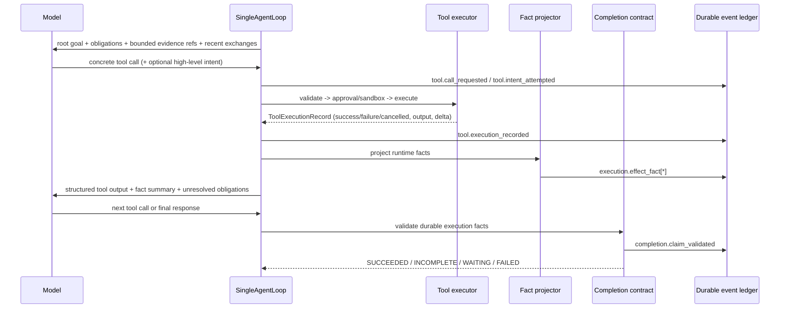

# 自动 Effect 推导与工具事实完成合同重构实施 Spec

## 1. 文档目的与范围

本 Spec 定义 `tsm-agt` 在 `SINGLE_LOOP` 路径中，从“模型声明 `expected_effects`，Runtime 尝试按声明完成校验”，迁移为“模型选择具体工具，Runtime 从实际执行结果推导 effect、证据与完成合同”的实施方案。

目标是对齐 Codex 的核心工程原则：**工具参数不是事实，工具执行结果才是事实；预览不是提交，真实 mutation delta 才是提交；模型文字不是完成证据，Runtime 持久化的事实链才是完成证据。** 同时吸收 Hermes 的公开 Agent loop 设计：全量会话独立保存，活动上下文只投影可恢复的工具调用与工具结果，压缩不会破坏持久化事实。

本次改造范围：

- 仅对 `SINGLE_LOOP` 新路径启用自动推导与新的完成合同；
- 允许模型保留可选的高层工作意图，移除其填写抽象 `expected_effects` 的必要性；
- 修复失败的 `MODIFY` / `VERIFY` 意图不能被静默遗忘的问题；
- 建立工具规格、执行记录、结果 authority、退出状态与 mutation journal 到 `EffectFact` 的统一投影；
- 保留旧 Task 的 legacy reader、resume、rollback 与历史事件解释能力，不物理删除 Router/Planner 或旧 `TaskSpec` reader；
- 不改变既有审批、sandbox、路径安全或工具参数校验的安全边界。

非目标：

- 不要求逐字复刻 Codex 或 Hermes 的 API / 数据结构；
- 不让模型自行声明“已经完成”来绕过 Runtime 合同；
- 不以模型文本、tool args、UI 预览或 patch diff 预估替代 committed mutation delta；
- 不在本 PR 强制移除全部 legacy 工具、历史事件或历史 UI；
- 不将所有解释类请求一律提升为 `EVIDENCE` 合同。仅当结论依赖当前 workspace、runtime 或外部可验证事实时才要求证据。

## 2. 触发问题：`task-120a03b313c846a9916cf65a68db9708`

该 Task 体现了现有抽象 `TurnIntent + expected_effects` 的失败模式：

1. Task 为新建 `SINGLE_LOOP` Task，`binding_kind = NEW`，`root_goal = “你直接帮我改啊”`，没有绑定此前已定位修改目标的 Task。
2. 模型先调用 `core.turn_intent`，传入：
   ```json
   {
     "intent": "MODIFY",
     "expected_effects": ["mutate", "observe", "verify"],
     "summary": "Read src/tsm_agt/web/app.py ..."
   }
   ```
3. `verify` 不是现有 `ToolEffect` 枚举值；当前合法值是 `observe`、`mutate`、`execute`、`interact`、`control`、`internal`。工具返回 `INVALID_PARAM`。
4. 后续只成功执行一次 `core.read_file`，没有搜索定位，也没有 `core.apply_patch` / `core.apply_patch_v4a`，mutation journal 为空。
5. 完成校验只看到成功的 `observe`，又因为失败的 `MODIFY` 未形成 durable obligation，最终把 Task 当作无 mutation 合同的 direct response 并错误写成 `SUCCEEDED`。

这不是只修一个枚举别名即可解决的问题，而是责任边界错误：模型同时被要求选择工具、声明抽象 effect、使用 Runtime 枚举词汇、并间接定义完成合同。一旦声明参数失败，系统就丢失了本应由 Runtime 持有的完成义务。

## 3. Codex / Hermes 研究结论

### 3.1 Codex：具体工具调用 → Runtime 执行 → 模型可见结果 → 下一轮推理

本地 Codex 源码体现的关键流程如下：

1. `codex-rs/core/src/session/turn.rs` 中的 `run_turn` 运行单一 turn loop。模型发出具体 tool call 后，Runtime 执行并把对应 tool output 追加到 history；下一次模型采样通过 `clone_history().for_prompt(...)` 看见 call/output 对。
2. `codex-rs/core/src/tools/parallel.rs` 的 `ToolCallRuntime::handle_tool_call` 把非 fatal `FunctionCallError` 转为模型可见的 tool output，保留 `call_id`。取消同样会生成 aborted output，而不是让调用在历史中消失。
3. `codex-rs/core/src/tools/handlers/shell.rs` 只负责解析具体 shell 参数；approval、sandbox 与真实执行由 ToolOrchestrator / executor 处理。工具结果包含真实 exit code、stdout、stderr、运行耗时等运行时事实。
4. `codex-rs/core/src/tools/handlers/apply_patch.rs` 中 streaming patch hunk 是预览，不能作为提交事实。只有 `parse_patch`、模式验证、文件系统执行后得到的真实结果才有权描述修改是否发生。
5. `codex-rs/core/src/tools/runtimes/apply_patch.rs` 返回 `AppliedPatchDelta`、exit code 与 stdout/stderr。即使命令整体失败，只要存在 committed delta，UI / turn diff 也必须以真实 delta 为准，不能只看模型参数或命令状态。
6. `codex-rs/core/src/tools/context.rs` 将 `FunctionToolOutput`、`ApplyPatchToolOutput`、`ExecCommandToolOutput` 投影为模型可见输出，但不把模型对效果的主观声明升级为系统事实。

可迁移原则：

- 工具 schema 描述“此工具可尝试什么”；
- executor / runtime 产出“这次调用实际发生了什么”；
- history 把成功、失败、取消与部分提交都原样回灌给模型；
- 完成判断使用 Runtime 事实，不使用模型声明的 abstract effect；
- preview、请求参数与实际文件提交是三类不同状态，必须分开存储和展示。

### 3.2 Hermes：持久会话与活动上下文分离

Hermes 无法在当前本地工作区获得完整源码；以下结论仅来自其公开开发文档和公开讨论，不将其表述为未验证的内部实现保证：

- Agent loop 基于 conversation history、tool runner 和 tool result append/re-entry；工具输出会成为下一轮可用的上下文。
- 完整 session 独立于当前活跃 prompt；context compression 针对活动上下文，不等于删除可审计的持久会话或工具结果。
- 工具结果可裁剪以满足上下文预算，但裁剪策略必须保留足以继续执行的关键事实与引用。
- 公开讨论涉及无效工具调用修复、tool result trimming 和 loop termination 等问题，说明调用失败必须作为明确的循环输入，而不能在编排层静默吞掉。

参考：

- [Hermes sessions](https://hermes-agent.nousresearch.com/docs/user-guide/sessions)
- [Hermes agent loop](https://hermes-agent.nousresearch.com/docs/developer-guide/agent-loop)
- [Hermes context compression and caching](https://hermes-agent.nousresearch.com/docs/developer-guide/context-compression-and-caching)
- [Hermes persistent memory](https://hermes-agent.nousresearch.com/docs/user-guide/features/memory)

可迁移原则：持久 ledger 是审计真相；active context 是面向下一轮模型调用的有界投影。压缩或 UI 省略都不能抹除完成合同所依据的 execution fact。

## 4. 目标架构

### 4.1 三层责任划分

| 层级 | 责任 | 权威输入 | 不负责 |
|---|---|---|---|
| Model action layer | 选择具体工具、提交参数、可选声明高层工作意图、读取前次工具结果并纠正 | tool schema、active context、工具结果 | 宣称真实 mutation、定义系统 effect、清除失败义务 |
| Runtime fact layer | 校验、审批、sandbox、执行、持久化原始记录、推导 `ToolExecutionFact` / `EffectFact` | ToolSpec、ToolExecutionRecord、authority、executor result、mutation journal | 根据 assistant prose 猜测完成 |
| Contract / projection layer | 将 root goal、continuation binding、intent attempt 与 execution facts 归并成 obligation；输出完成状态、UI/trace 投影 | durable task metadata、event ledger、effect facts | 以预览或模型说明伪造证据 |

### 4.2 SINGLE_LOOP 主流程



不变量：

1. 每个已受理的 tool call 都必须有终态 `ToolExecutionRecord`：成功、失败、拒绝、取消或超时；不得无声丢失。
2. 每个终态 record 都可被投影为零个或多个 `EffectFact`；“零个”是有效结果，不代表调用没有发生。
3. `EffectFact` 的来源、状态和 authority 必须可追溯到 execution record / journal，而不是 assistant text。
4. 未满足 obligation 的 final assistant text 只能导致 `INCOMPLETE`、`WAITING` 或 `FAILED`，不能导致 `SUCCEEDED`。
5. active context 可压缩；ledger、Task metadata、obligation 和 committed delta 不可由压缩删除。

## 5. 目标数据模型

以下为目标语义模型；字段名可按仓库既有命名与序列化约束落地。

### 5.1 保留但降级的 `TurnIntent`

将现有模型可填的 `TurnIntent` 分拆为“意图尝试”和“Runtime 推导的合同输入”。

```python
class WorkIntent(str, Enum):
    INVESTIGATE = "INVESTIGATE"
    MODIFY = "MODIFY"
    VERIFY = "VERIFY"
    INSPECT_RUNTIME = "INSPECT_RUNTIME"
    DIRECT_RESPONSE = "DIRECT_RESPONSE"

@dataclass(frozen=True)
class ToolIntentRequest:
    """模型提供的非权威工作提示；不直接定义交付事实。"""
    intent: WorkIntent | None
    summary: str | None
    continuation_task_id: str | None
```

要求：

- 新 schema 删除 `expected_effects`；模型不再提交 `ToolEffect` 枚举列表。
- `intent` 可选。模型未调用 intent 工具或调用失败时，Runtime 仍可从具体工具事实推导 delivery effect。
- `summary` 仅用于 UI、审计和上下文摘要，永远不是 evidence。
- `continuation_task_id` 仅是候选绑定，必须由 Binder / Runtime 验证其存在性、可访问性、分支关系和 task 状态。

### 5.2 `IntentAttempt`

无论 intent request 合法、被归一化还是无效，均持久化一次尝试，防止失败声明被遗忘。

```python
class IntentAttemptStatus(str, Enum):
    ACCEPTED = "accepted"
    NORMALIZED = "normalized"
    REJECTED = "rejected"

@dataclass(frozen=True)
class IntentAttempt:
    attempt_id: str
    task_id: str
    turn_id: str
    call_id: str
    requested_intent: str | None
    normalized_intent: WorkIntent | None
    status: IntentAttemptStatus
    validation_error: StructuredValidationError | None
    implied_effects: tuple[RequiredEffect, ...]
    continuation_reference: str | None
    created_at: datetime
```

关键语义：

- `REJECTED` 不等于不存在。若原请求表达了可解析的 `MODIFY` / `VERIFY`，必须保留其 implied obligation；无法解析时至少保留“intent declaration failed”的 corrective signal。
- `NORMALIZED` 表示只发生了安全、无歧义的 canonical alias 修复，例如迁移期的 `verify -> execute` effect alias；它不改变真实工具事实。
- `ACCEPTED` 只说明意图结构有效，不说明工作已完成。

### 5.3 `ToolExecutionFact` 与 `EffectFact`

`ToolExecutionRecord` 是 executor 原始终态记录；`ToolExecutionFact` 是其稳定、可用于合同的投影；`EffectFact` 是执行事实中满足或破坏某种交付 effect 的结论。

```python
class FactOrigin(str, Enum):
    TOOL_SPEC = "tool_spec"
    EXECUTOR = "executor"
    RESULT_PAYLOAD = "result_payload"
    MUTATION_JOURNAL = "mutation_journal"
    PROCESS_STATUS = "process_status"
    APPROVAL = "approval"
    SANDBOX = "sandbox"

class EffectStatus(str, Enum):
    DELIVERED = "delivered"
    PARTIAL = "partial"
    NOT_DELIVERED = "not_delivered"
    BLOCKED = "blocked"
    UNKNOWN = "unknown"

@dataclass(frozen=True)
class ToolExecutionFact:
    fact_id: str
    task_id: str
    turn_id: str
    call_id: str
    tool_name: str
    invocation_status: InvocationStatus
    result_authority: ToolResultAuthority
    origins: tuple[FactOrigin, ...]
    execution_record_ref: str
    mutation_journal_refs: tuple[str, ...]
    evidence_refs: tuple[str, ...]
    committed_delta: CommittedDeltaSummary | None
    process_result: ProcessResultSummary | None
    approval_result: ApprovalResult | None
    sandbox_result: SandboxResult | None

@dataclass(frozen=True)
class EffectFact:
    effect_fact_id: str
    execution_fact_id: str
    effect: ToolEffect
    scope: EffectScope
    status: EffectStatus
    authority: ToolResultAuthority
    reason_code: str
    evidence_refs: tuple[str, ...]
    committed_delta_refs: tuple[str, ...]
```

`ExecutionFact` / `EffectFact` 应复用并演进现有 `src/tsm_agt/core/execution_facts.py` 的 `ExecutionFact`、`EffectStatus`、`classify_effect_status`、`project_execution_facts`，避免另起平行事实体系。必要时先扩展现有类型，再引入清晰的 `effect_fact` 命名事件。

### 5.4 `RequiredEffect` 与 Obligation

```python
@dataclass(frozen=True)
class RequiredEffect:
    effect: ToolEffect
    scope: EffectScope
    source: RequirementSource  # root_goal / binding / intent_attempt / explicit_user_request
    source_ref: str
    strength: RequirementStrength  # hard / recoverable
    satisfiable_by: tuple[ToolEffect, ...]
```

- `hard`：用户明确要求修改、验证、查询 runtime / workspace，或 continuation binding 明确继承的未完成交付。
- `recoverable`：失败或无效 intent 尝试产生的义务；允许模型在下一轮纠正、澄清或转入 `WAITING`，但不允许 silent success。
- root goal 的强义务优先于 optional intent。`MODIFY` 既不是模型自己说了就必然生效，也不能在失败后自动消失。

## 6. 自动 Effect 推导规则

### 6.1 Effect 的语义

保留现有 `ToolEffect`：`observe`、`mutate`、`execute`、`interact`、`control`、`internal`。不新增 `verify` 作为并列 Runtime 枚举；业务语义 `VERIFY` 映射到 `execute`，再由具体校验结果补充 `verify` 语境 / scope。

| 高层工作意图 | 默认 implied delivery effect | 是否可单独证明完成 |
|---|---|---|
| `INVESTIGATE` | `observe` | 否；需与用户问题 / evidence scope 匹配 |
| `MODIFY` | `mutate` | 否；需 committed net delta 与目标匹配 |
| `VERIFY` | `execute` | 否；需被认可的验证命令/测试及成功或可解释的 partial 结果 |
| `INSPECT_RUNTIME` | `observe`（scope=`runtime`） | 否；需 runtime authority 结果 |
| `DIRECT_RESPONSE` | 无 | 仅限不依赖 workspace/runtime/external 当前事实的问题 |

### 6.2 从具体工具推导的基础规则

| 具体工具类别 | 先决条件 | 推导 effect | 不推导的情形 |
|---|---|---|---|
| `core.read_file`、`core.search_files` | executor 成功且返回受 authority 保护的内容/命中 | `observe(workspace)` | 校验失败、拒绝、空 output 或内容不可用时仅记录执行，不交付 observe evidence |
| runtime inspection 工具 | 有效 runtime/session authority 且调用成功 | `observe(runtime)` | 只读到缓存/预览且 authority 不足时不可满足 runtime observation |
| patch / write / edit 工具 | mutation journal 记录真实 committed net delta | `mutate(workspace)` | 仅生成 patch、dry-run、审批等待、delta 为空、执行失败且无 delta |
| shell / process 工具 | 真实 process started / completed 且 result authority 可信 | `execute(process)` | 仅参数解析、未获审批、sandbox 拒绝、未启动、取消前未执行 |
| validation/test command | process 完成，目标匹配且 exit/result 满足 validator | `execute(verification)` | command 成功但与目标无关、输出被截断且无法判断、exit non-zero 而没有预期失败语义 |
| approval / interaction 工具 | 用户输入已持久化且 confirmed | `interact` | prompt 展示但未确认 |
| internal / context / telemetry 工具 | 任意 | 可写 `internal` facts | 不得满足用户交付 effect |

### 6.3 Mutation 与 process 的细化

1. **mutation 以 committed delta 为准**
   - `ToolSpec.effect == mutate` 仅说明该工具可能产生 mutation，不表示已经 mutation。
   - `ToolExecutionRecord.success = True` 但 net delta 为空时，生成 `EffectFact(mutate, NOT_DELIVERED, reason_code="no_committed_delta")`。
   - record 失败但 mutation journal 有 committed delta 时，生成 `EffectFact(mutate, PARTIAL, reason_code="delta_committed_before_failure")`；UI 显示“部分修改已提交，调用失败”，completion validator 决定是否还欠后续验证或修复。
   - patch preview、模型提供的 patch text、diff 预估只允许产生 `preview` / `proposed` UI 数据，不得产生 `mutate` delivered fact。

2. **execute 以真实执行终态为准**
   - `execute` 需要 executor 记录的启动/完成状态；仅 shell args 解析成功不能交付。
   - 对 `VERIFY`，validator 必须同时检查 command 分类、目标作用域、exit code、测试摘要和允许的 expected failure 语义。
   - 非零 exit code 默认产生 `NOT_DELIVERED` 或 `PARTIAL`，而不是将 stdout 中“看起来正常”的文字当成功。

3. **observe 不是万能完成证据**
   - `observe` 可以满足调查、读取、查询类 obligation；不能替代 `mutate` 或 `execute`。
   - 现有 `_NON_EFFECTFUL` 把 `OBSERVE` 视为对 effect-level delivery 非效应的逻辑，需要调整为“observe 可满足相同 scope 的 observation obligation，但不可满足 modify/verify obligation”，而不是全局把 observe 当无效。

4. **authority 决定证据资格**
   - `ToolResultAuthority` 用于区分可信 executor 结果、模型生成文本、缓存/提示、用户确认等来源。
   - 只有满足目标 effect 最低 authority 的 `EffectFact` 才可清除对应 obligation。尤其 mutation 必须有 mutation journal / filesystem executor authority，runtime observation 必须有 runtime inspector authority。

### 6.4 高层 intent 与实际工具事实的合并

合并规则按优先级：

1. 用户 root goal、显式 continuation binding 的 hard obligations；
2. 已持久化未完成 obligation；
3. 有效或可解析的 `IntentAttempt` 产生的 recoverable obligation；
4. 实际 `EffectFact`；
5. assistant final text（只说明，零证据权威）。

算法：

```python
obligations = obligations_from_root_goal_and_binding(task)
obligations += recoverable_obligations_from_intent_attempts(task)
facts = project_effect_facts(execution_records, tool_specs, mutation_journal)

for obligation in deduplicate_by_effect_and_scope(obligations):
    matching = facts.match(obligation.effect, obligation.scope)
    if matching.has_delivered_with_required_authority():
        satisfy(obligation, matching.best_evidence())
    elif matching.has_partial_or_blocked():
        retain_with_diagnostic(obligation, matching)
    else:
        retain_with_gap(obligation)
```

具体工具调用可以在没有 `TurnIntent` 的情况下满足 root obligation；意图尝试不能在没有真实工具事实的情况下满足任何 effect。

## 7. 参数校验、兼容与模型恢复

### 7.1 新协议

新 `core.turn_intent` schema：

```json
{
  "intent": "MODIFY",
  "summary": "可选，说明准备做什么",
  "continuation_task_id": "可选，候选前序任务"
}
```

删除 `expected_effects`。模型只使用面向用户的 `MODIFY` / `VERIFY` 词汇，不再被迫知道 `ToolEffect.execute`。

### 7.2 迁移期 legacy 兼容

在协议迁移的兼容窗口内，legacy reader 可以读取历史 `expected_effects`，但新的 SINGLE_LOOP writer 不再生成它。

如需暂时接收旧 provider 仍输出的字段：

- schema 设置为尽可能严格，未知字段优先返回结构化错误；
- 仅对无歧义且安全的 canonical alias 进行 local normalization，例如 legacy `verify` 归一为 `execute`；
- normalization 结果写入 `tool.intent_normalized`，保留原始值、版本、原因与 canonical 值；
- 不做模糊猜测，不把任意字符串纠正为 mutation / command，也不从 summary 猜 effect；
- 归一化只处理过渡输入，不赋予实际 effect；真实 `EffectFact` 仍只能来自具体工具执行。

建议定义：

```python
SAFE_EFFECT_ALIASES = {
    "verify": ToolEffect.EXECUTE,
}
```

如 alias 可影响权限、审批、sandbox、工具选择或完成状态，则不得自动归一化，必须拒绝并请求模型重试。

### 7.3 结构化失败回灌

所有参数校验失败必须返回模型可见、可机器读取的输出：

```json
{
  "status": "invalid_param",
  "call_id": "...",
  "field": "expected_effects[2]",
  "received": "verify",
  "expected": ["observe", "mutate", "execute", "interact", "control", "internal"],
  "normalized_to": null,
  "retry_safe": true,
  "obligation_status": "modify_obligation_retained"
}
```

要求：

- 失败输出附带同一 `call_id`，进入下一轮 active context；
- 清楚说明是否可安全重试、是否已执行任何副作用、是否保留 obligation；
- `INVALID_PARAM`、approval denied、sandbox blocked、timeout、cancelled、partial delta 必须是不同 reason code；
- 对 mutation 工具，失败回灌必须明确 `committed_delta` 是否为空，避免模型误以为没有改动或重复执行造成二次修改。

## 8. Completion 合同重构

### 8.1 当前问题

`src/tsm_agt/core/single_loop/contracts.py` 当前主要依据成功的 execution records、成功 `TurnIntent` 与 root-goal anchor 判断。失败 intent 没有 durable obligation，导致 `task-120...` 在只有一次 read 时被视作成功。

### 8.2 新 validator 输入

completion validator 必须显式输入：

- task root goal 与 `TaskBinding` / continuation 解析结果；
- 未关闭的 `RequiredEffect`；
- 全部 `IntentAttempt`（包括 rejected / normalized）；
- `ToolExecutionRecord` 与 `ToolExecutionFact`；
- `EffectFact` 与 evidence refs；
- mutation journal；
- 当前终态候选（final response、interrupt、approval pending、tool loop exhausted）。

禁止仅根据 “最后一次成功工具结果” 或 “final answer 文本存在” 判定完成。

### 8.3 终态规则

| 条件 | 合法终态 | 不合法终态 |
|---|---|---|
| hard mutate obligation 无 `mutate:DELIVERED` | `INCOMPLETE`、`WAITING`、`FAILED` | `SUCCEEDED` |
| rejected MODIFY attempt 且未有后续 mutation / 澄清 | `INCOMPLETE` 或继续 loop | `SUCCEEDED` |
| VERIFY obligation 未产生成功的目标验证事实 | `INCOMPLETE`、`FAILED` | `SUCCEEDED` |
| mutation partial delta 后执行失败 | `INCOMPLETE` 或 `FAILED`，必须说明 delta | 仅按工具失败丢弃 delta；无说明的 `SUCCEEDED` |
| 需用户审批 / 澄清 | `WAITING` | 伪装成完成 |
| direct conceptual response，且无需当前事实 | `SUCCEEDED` | 强制要求不存在的 evidence |
| observation-only 调查已匹配 root scope | `SUCCEEDED` | 因没有 mutation 无条件失败 |

final text 是 contract 的说明字段，而不是满足条件。它可以引用 fact IDs / evidence refs；不能删除或者覆盖未满足的 obligation。

### 8.4 Continuation / Binder 规则

`task-120...` 的第二个根因是“你直接帮我改啊”创建了新的 `NEW` Task，而没有绑定包含具体文件目标的前序 Task。需要对 Binder 引入显式规则：

1. 若用户表达 continuation（例如“直接改”“继续”“按刚才方案实施”）且前序 Task 未完成 mutation obligation，Binder 必须优先生成 `CONTINUATION` binding，继承 root goal、目标 refs 和未完成 obligations。
2. 若存在多个候选前序 Task 或目标歧义，创建 `WAITING` / clarification，不得任意绑定，也不得创建丢失目标的无合同 NEW Task。
3. 若确实创建 `NEW` Task，metadata 必须记录 `binding_kind=NEW` 与无继承依据；对于“修改”语义的新 root goal，仍从用户语义创建 hard `mutate` obligation。
4. Binder 失败、无可用候选或跨边界不可访问都必须留事件和模型可见诊断；不能 silent fallback 为无 mutation 的 direct response。

### 8.5 `INCOMPLETE`、`WAITING` 与输出缓冲

沿用既有 SINGLE_LOOP 输出策略并强化：

- assistant candidate text 只缓冲；
- 只有 contract validator 输出 `SUCCEEDED` 且 final result 已持久化后才能发布最终文本；
- tool call、`INCOMPLETE`、`WAITING`、SIGINT、approval pending 或未决 contract gap 不得发布候选文本为最终回答；
- UI 展示 gaps、已提交 delta、可恢复 action 与 evidence ref，不把 assistant prose 显示为“已验证”。

## 9. 事件、持久化与投影

### 9.1 新增 / 演进事件

| 事件 | 何时写入 | 最小字段 | 用途 |
|---|---|---|---|
| `tool.intent_attempted` | 收到意图 request 后，校验前 | `call_id`、原始 intent、raw schema version | 审计与失败不丢失 |
| `tool.intent_accepted` | 结构校验通过 | normalized intent、implied obligations | 上下文/UI 提示 |
| `tool.intent_normalized` | 安全 alias 归一 | received、canonical、reason、schema version | 兼容审计 |
| `tool.intent_rejected` | 参数或语义无效 | structured error、retained obligation refs | 模型恢复 |
| `tool.execution_recorded` | executor 产生终态 record | record ref、status、authority、side-effect state | 真正的调用终态 |
| `execution.fact_projected` | 从 record 投影事实 | fact ref、origin、evidence refs | 可审计事实层 |
| `execution.effect_fact` | 产生 effect 结论 | effect、scope、status、reason、delta refs | completion 输入 |
| `contract.obligation_created` | root/binding/intent 形成义务 | source、strength、effect、scope | durable contract |
| `contract.obligation_updated` | fact 满足或阻塞义务 | prior/new state、fact refs | 审计状态变化 |
| `completion.claim_validated` | 终态判定 | gaps、satisfied refs、candidate status、validator version | 最终决定依据 |

事件统一带 `task_id`、`turn_id`、`event_id`、时间戳、schema/version；使用 append-only 写入。对大 payload 只存摘要 + immutable blob / evidence ref，避免活跃上下文与事件膨胀。

### 9.2 向后兼容

- 旧 `turn.intent_*` 事件保留 reader；projector 通过 event version 识别 legacy / v2。
- 新 writer 只写 v2 `tool.intent_*` 与 `execution.effect_fact`；必要时可双写有限过渡字段供旧 UI 使用，但不以双写字段作为 completion 权威。
- 历史 `expected_effects` 只能用于 legacy 解释和迁移投影，不能为既有 Task 自动补造 “已完成”事实。
- 旧 Task 的 resume / rollback 保持 legacy execution path；新 Task 的 metadata 固定 `orchestration_mode=SINGLE_LOOP`，不得 silent fallback 到 legacy。
- 事件升级应具备 idempotency key，重放不可重复创建 effect / obligation。

### 9.3 Active context 投影

active context 只投影：

- root goal、binding 目标摘要；
- 未满足 obligations 及其 diagnostic；
- 最近有限数量工具 call/output 对；
- 必需的 `EffectFact` / evidence refs / committed delta summary；
- pending approval / clarification。

不得投影：

- 全量旧 assistant prose；
- 超预算原始 stdout/stderr、整文件内容或所有历史搜索结果；
- 被 UI 省略的 preview 当作事实。

压缩后的 summary 必须保留事实 ref 和 obligation ID；详情按需通过 inspection / evidence 工具读取。

## 10. 代码改动映射

以下文件映射为当前已知落点；实现前须重新读取实际接口与测试组织，不应机械套用。

| 模块 / 文件 | 主要改动 |
|---|---|
| `src/tsm_agt/ports/tool.py` | 明确 `ToolSpec` effect 是能力声明；补充 effect scope、最小 authority / result classification 元数据；保留并规范 `ToolResultAuthority` |
| `src/tsm_agt/adapters/builtin/turn_intent_tools.py` | 新 schema 删除 `expected_effects`；实现迁移期 alias / structured recovery；写 `IntentAttempt` 事件 |
| `src/tsm_agt/core/kernel_tool.py` | 将 `declare_turn_intent` 从 completion 权威改为意图尝试登记；确保所有调用返回结构化终态与 call ID |
| `src/tsm_agt/core/execution_facts.py` | 演进 execution/effect projector；接入 authority、process、mutation journal、scope；调整 observe 的合同语义 |
| `src/tsm_agt/core/single_loop/contracts.py` | 以 obligation + `EffectFact` 重写完成校验；保留 rejected intent obligation；移除“无成功 intent 即无合同”的漏洞 |
| `src/tsm_agt/core/single_loop/*` | 在 tool result 回灌前投影事实；在 active context 中加入 gaps、事实摘要和 recovery output |
| Binder / Task metadata 相关模块 | continuation 解析与不完成 obligation 继承；对“直接改/继续”建立显式绑定或 WAITING |
| mutation journal / patch executor | 暴露 committed delta / partial delta 的稳定 summary 与 refs；明确 preview 与 commit 分离 |
| event store / projector | 加入 v2 事件 reader/writer、idempotency、legacy projection 兼容 |
| Web / SDK projection | 展示 obligation、effect fact、delta 与 completion gaps；区分“尝试”“预览”“实际提交”“验证完成” |

接口设计约束：

- 不向核心入口增加难以理解的 `bool` / `None` 位置参数；使用 named / typed 状态；
- `EffectFact` 不允许由 adapter 直接伪造 delivered 状态，必须由统一 projector 基于 record/journal 生成；
- 不为单次调用引入无复用价值的小 helper；
- 对外 API / SDK 事件字段新增采用版本化和 optional 兼容策略，避免破坏历史回放。

## 11. 分阶段 PR 计划

每阶段可独立回滚、可审查，累计生产代码变更应保持可控；不将本方案一次性堆入单个超大 PR。

### PR-A：事实模型与只读影子投影

内容：

- 扩展 `ToolExecutionRecord -> ToolExecutionFact -> EffectFact` projector；
- 为 read/search、runtime inspect、patch/write、process、internal 工具建立映射；
- 写 `execution.fact_projected` / `execution.effect_fact` shadow events；
- 不改变当前 completion outcome，只记录新旧投影差异和 telemetry。

验收：

- 可从任意 SINGLE_LOOP Task 重放得到稳定 effect facts；
- patch preview 不产出 mutate delivered；
- failed call 有 record/fact 且不丢 call ID；
- 不影响 legacy Task reader/resume/rollback。

### PR-B：IntentAttempt 与 schema 迁移

内容：

- 新 `core.turn_intent` schema 删除 `expected_effects`；
- 引入 `ToolIntentRequest` / `IntentAttempt`、`tool.intent_*` 事件；
- 为兼容窗口增加严格、有限 alias normalization；
- 向模型返回 structured invalid-param / recovery output。

验收：

- `verify` legacy 输入要么严格拒绝并保留 modify obligation，要么按版本策略规范化为 `execute` 并记录；
- 无效 intent 不影响后续具体工具调用；
- 没有 intent call 的工具路径仍能生成 effect facts；
- 新 SINGLE_LOOP writer 不再持久化模型 `expected_effects`。

### PR-C：Obligation 聚合与 completion shadow validator

内容：

- 从 root goal、binding 和 `IntentAttempt` 派生 `RequiredEffect`；
- 新 contract validator 以 `EffectFact` 为输入，在 shadow 模式写出新 gaps/outcome；
- 统计旧 / 新 validator 分歧，覆盖 task-120 类失败意图场景。

验收：

- `MODIFY` 失败后只 read_file 的 Task 在 shadow outcome 中绝不为 success；
- pure conceptual answer 不被错误要求 evidence；
- observe 可满足同 scope 调查合同，不可满足 modify/verify；
- partial committed delta 被保留并显示。

### PR-D：Binder continuation 与显式 WAITING

内容：

- 实现 continuation candidate 选择、未完成 obligation 继承、歧义时 WAITING；
- 为显式“直接改/继续”创建绑定诊断与 trace；
- root goal 是 modification 时，新 Task 也建立 hard mutate obligation。

验收：

- 前序已定位文件的“直接改”进入正确 continuation 或明确请求澄清；
- 不再无声创建丢失修改目标的 NEW Task 并 success；
- legacy task 继续走旧 reader 但绑定信息可见。

### PR-E：切换 SINGLE_LOOP completion 权威与 UI/SDK

内容：

- 开关启用新 validator 作为 SINGLE_LOOP completion 权威；
- Web / SDK 展示 effect facts、obligation state、committed delta、gaps 和 WAITING 原因；
- 保持候选 final text 缓冲到 validator success 后发布。

验收：

- task-120 回归：invalid MODIFY + only read_file => `INCOMPLETE`，并给模型可恢复错误；
- successful mutation 有 journal delta 后才 `SUCCEEDED`；
- approval pending / interrupt / tool failure 不泄露为最终成功文本；
- Legacy Task 仍能读取、恢复和回滚。

### PR-F：观测、迁移完成与 legacy 收敛决策

内容：

- 增加指标：invalid intent、normalization、effect/projector 分歧、blocked obligations、partial deltas、incorrect-success prevention；
- 持续至少一个兼容周期观察 legacy reader；
- 到期后单独评估删除 legacy writer / Router Planner 调用路径，不能和本方案混合上线。

验收：

- 新路径不存在 silent fallback；
- 无高频新旧 contract 分歧；
- 有明确历史 Task 保留周期和删除决策记录。

## 12. 测试矩阵

### 12.1 单元测试

1. `project_execution_facts`：
   - `read_file` success -> `observe:DELIVERED(workspace)`；
   - `search_files` 空命中仍记录调用；是否满足 observation 由 obligation scope 决定；
   - patch preview -> 无 `mutate:DELIVERED`；
   - patch success + journal delta -> `mutate:DELIVERED`；
   - patch failure + committed delta -> `mutate:PARTIAL`；
   - process completed / non-zero / cancelled / never-started 的 execute 分类；
   - internal 工具绝不满足用户 delivery effect；
   - authority 不足时不满足 obligation。
2. `IntentAttempt`：
   - accepted、normalized、rejected 都能序列化、重放、幂等；
   - rejected MODIFY 仍产生 recoverable mutate obligation；
   - `verify -> execute` 只在启用的 legacy schema version 下归一化；
   - 未知 / 高风险 alias 必须拒绝。
3. completion contract：
   - `MODIFY` + only observe -> gap；
   - `VERIFY` + only observe -> gap；
   - direct conceptual answer -> 无 effect gap；
   - user explicit current-workspace fact -> observe evidence gap；
   - final prose 不会清除 gap；
   - partial delta 不能丢失。

### 12.2 集成测试

1. 单 Agent tool loop：无效 intent tool call 结果回灌到同一模型 loop，模型随后 read/search/edit，最终 contract 按真实 facts 判断。
2. task-120 回归 fixture：`verify` 参数无效、随后只读文件、没有 patch 时终态必须为 `INCOMPLETE`，`mutation_journal` 保持空且 gap 明确。
3. 成功修改：search/read -> patch -> journal delta -> targeted validation -> `SUCCEEDED`；校验 evidence 指向真实 record/journal。
4. patch 部分提交后失败：UI/SDK 显示 committed delta，终态不是无信息的 failed/success。
5. continuation：前序未完成 modify Task 接收“直接改”，绑定继承目标；候选不唯一时 `WAITING`。
6. approval / sandbox：拒绝和待确认都生成 tool result / fact，且不误满足 mutate / execute。
7. streaming：SINGLE_LOOP candidate final text 在 completion success 前不外泄。
8. 重放：重放 ledger 不重复写 mutation / obligation，effect facts 稳定。

### 12.3 兼容与非回归

- 显式 `OrchestrationMode.LEGACY` fixture 继续验证 Router/Planner/旧 TaskSpec；
- 历史事件 reader、resume、rollback、Web 旧 trace 展示不崩溃；
- 默认新 Task `SINGLE_LOOP`，不存在模式静默降级；
- 全量 pytest、compileall、`git diff --check`；代码改动时执行项目约定的针对性测试与完整回归。

## 13. 发布、指标与回滚

### 13.1 Feature flags

建议分离开关：

- `single_loop_effect_fact_projection=shadow|active`
- `single_loop_intent_v2_schema=off|accept_legacy|strict`
- `single_loop_contract_validator=legacy|shadow|active`
- `single_loop_continuation_binding=off|shadow|active`

禁止用单一大开关同时切 schema、事实投影、完成判定和 Binder，避免故障无法定位。

### 13.2 核心指标

- `intent_attempt_rejected_total{intent,reason}`
- `intent_normalized_total{alias}`
- `effect_fact_total{effect,status,tool_name,authority}`
- `completion_gap_total{effect,source,reason}`
- `completion_validator_divergence_total{legacy_outcome,new_outcome}`
- `partial_mutation_total{tool_name,reason}`
- `continuation_binding_total{result}`
- `incorrect_success_prevented_total{gap_reason}`

所有指标只使用 task / tool 类别、schema 版本、reason code 等低基数字段；不以用户文本、文件路径全文或 stdout 作为 label。

### 13.3 回滚策略

- 回滚只切换新 Task 的 contract authority 到 legacy 或 shadow，不删除已写 ledger；
- v2 events、effect facts、intent attempts 必须保持 reader 可读；
- 已有 committed mutation 绝不可因 contract rollback 自动回滚；回滚动作仍走现有明确 rollback 流程；
- 对新 schema 无法被旧模型理解时，返回明确 structured error，不 silent fallback 到“无合同成功”。

## 14. 风险与缓解

| 风险 | 缓解 |
|---|---|
| 工具 metadata 错配导致 effect 误判 | shadow projector + golden fixtures + per-tool mapping review |
| 过度从高层 intent 生成 obligation，阻断合理回答 | 仅 root/binding 强制；intent attempt 为 recoverable；概念问答无 evidence 合同 |
| 未绑定前序 Task 造成目标丢失 | Binder continuation rules + ambiguity WAITING + root goal modifier detection |
| 失败工具循环消耗 token | structured recovery output、保留 call ID、active context 仅保留关键 diagnostic |
| 部分 mutation 被当作完全失败或完全成功 | delta-first fact、`PARTIAL` 状态、UI 明确展示 |
| legacy 历史无法读取 | 版本化 reader、dual-read、显式 legacy fixtures |
| event / context 体积增长 | evidence ref、摘要、上限与按需 inspection；ledger 与 active context 分离 |
| schema normalization 变成权限绕过 | 仅安全无歧义 alias；影响审批/安全的输入一律拒绝 |

## 15. 完成定义

该重构完成的最低标准：

1. 新 SINGLE_LOOP Task 不需要模型填写 `expected_effects`。
2. 实际 read/search、runtime inspection、mutation、process、approval 等工具结果可被 Runtime 统一投影为带 authority 的 `EffectFact`。
3. mutation 只有在真实 committed delta 后才能满足 mutate；验证只有在真实、目标匹配的 process result 后才能满足 execute/verify。
4. 无效或失败的 MODIFY/VERIFY intent 不会被静默丢弃；它会保留可恢复 obligation，并在最终无证据时阻止 `SUCCEEDED`。
5. `task-120a03b313c846a9916cf65a68db9708` 类路径（无效 `verify`、只读文件、无 patch）稳定得到 `INCOMPLETE` 或后续恢复，不再错误成功。
6. continuation 能显式继承前序未完成目标，歧义时进入 `WAITING`。
7. 全量 ledger 可审计、active context 有界；UI 明确区分意图、尝试、预览、实际提交、验证与最终合同状态。
8. 历史 legacy Task 的读取、恢复和回滚兼容仍存在，直到单独的兼容周期结束与删除决策获批。
