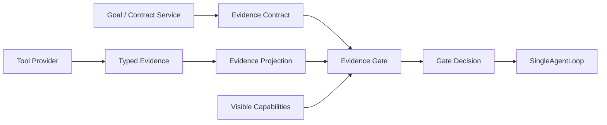

# 通用证据合同重构 Spec

## 1. 目标

将任务完成从“模型文本声称完成”或“出现某种 ToolEffect”改为：

```text
用户 Goal/Contract
→ 工具结果产生 Typed Evidence
→ Gate/Policy 解析合同
→ Loop 执行统一决策
```

Core 不认识 GitHub、网页、源码比较或任何业务关键词。新增能力只注册证据类型、Gate 或 Provider，不改 Loop。

## 2. 上游参考与设计结论

### DeepSeek Harness

`dsh-goal` 是独立、持久化的 Goal service：用户或 agent 可创建、编辑、暂停、恢复、完成或阻塞目标；Goal service 只保存状态，不调度工作，也不自行决定完成。调度与领域判定由独立消费者完成。

采用：

- Goal/Contract 是独立持久状态，不塞入 agent loop；
- Contract/Gate 与 loop driver 解耦；
- `blocked` 是稳定状态，不是 task failure；
- 事实从 durable session event 投影，不依赖模型记忆。

### Hermes

Hermes 的 `/goal` 提供可选 completion contract：用户可直接填写 `outcome`、`verification`、`constraints`、`boundaries`、`stop_when`；模型可以 `draft` 草案，但用户可以查看、修改或采用。其 deterministic quality gate 在 judge 前执行，失败时将命令输出作为 continuation 上下文；Gate 不可运行或重试耗尽时暂停而非宣称完成。

采用：

- 用户声明是严格合同的权威；模型草案只作为提议；
- 自由文本 Contract 用于引导模型和 judge；
- 机械可验证条件必须以 Gate 单独表达；
- Gate 失败进入 blocked/paused，不无限续跑。

## 3. 必须移除的耦合

以下逻辑不进入 Core：

- 根据 `源码`、`GitHub`、`对比` 等关键词创建完成条件；
- 用 `OBSERVE` 表示任何可满足的证据；
- 让 `web.search`、网页内容、Issue 与源码文件共享同一种完成事实；
- 让模型草案静默成为强制合同；
- 能力缺失时无限 continuation；
- 参数错误直接使整个 Task 失败。

## 4. 分层模型



### 4.1 Goal / Contract Service

Contract 是与 Task 关联的独立持久对象，而不是由 Core 解析自然语言后隐式生成。

```python
@dataclass(frozen=True)
class TaskContract:
    objective: str
    guidance: ContractGuidance
    evidence_requirements: tuple[EvidenceRequirement, ...]
    gates: tuple[EvidenceGate, ...]
    authority: ContractAuthority
```

```text
ContractAuthority.USER     用户/API 显式设置，可强制
ContractAuthority.DRAFT    模型草案，只显示/建议，不可强制
```

普通任务可以没有 Contract；无 Contract 时沿用当前正常完成路径。

用户/API 可直接创建严格 requirement，例如：

```yaml
objective: 对比两个公开实现
requirements:
  - kind: source.artifact
    minimum_count: 2
    distinct_by: repository
    predicates:
      immutable_revision: true
      complete: true
```

模型可以生成同样的草案，但 Runtime 必须等待用户/API 接受后才将其提升为 `USER` authority。

### 4.2 Evidence Capability

工具声明它**可产生**的证据能力，不只声明读写效果。

```python
@dataclass(frozen=True)
class EvidenceCapability:
    capability_id: str
```

示例：

```text
web.discovery
web.document
source.artifact
runtime.inspection
workspace.artifact
command.verification
```

`ToolEffect` 保留用于权限、审批、并发和副作用；不再承担证据完成语义。

### 4.3 Typed Evidence

Provider 将 ToolResult 归一化为事实，写入现有 durable event / Task snapshot。

```python
@dataclass(frozen=True)
class EvidenceFact:
    fact_id: str
    kind: str
    execution_ref: str
    attributes: Mapping[str, JsonValue]
    provenance: Mapping[str, JsonValue]
    complete: bool
```

约束：

- `web.discovery`：候选 URL、标题、查询来源；不可满足实现级 requirement。
- `web.document`：已读取内容、canonical URL、content hash；可满足文档类 requirement。
- `source.artifact`：repository、immutable revision、path、blob identity、content hash；可满足实现级 requirement。
- 失败、截断或未知结果不可产生 `complete=True` 的对应事实。

### 4.4 Evidence Gate

Gate 是独立 policy，消费 Contract、Evidence Projection 和当前可见 capability。

```python
class GateResolution(StrEnum):
    PASS = "PASS"
    CONTINUE = "CONTINUE"
    BLOCKED = "BLOCKED"

@dataclass(frozen=True)
class GateDecision:
    resolution: GateResolution
    missing_requirement_ids: tuple[str, ...]
    required_capability_ids: tuple[str, ...]
    reason_code: str
    detail: str
```

规则：

```text
无强制 Contract 或所有 requirements 满足
→ PASS

存在缺失 requirement，且至少一个确切 satisfier capability 可见
→ CONTINUE

存在缺失 requirement，但不存在 satisfier capability
→ BLOCKED
```

`CONTINUE` 不允许依据宽泛 `OBSERVE` 推断，只能依据 requirement 与 capability 的明确匹配。

## 5. Loop 边界

`SingleAgentLoop` 不理解任何 evidence kind。

```text
PASS
→ 正常 final response

CONTINUE
→ 注入 structured continuation，包含缺失 requirement 和允许 capability

BLOCKED
→ 结束为 incomplete / awaiting user，输出缺失能力、gate reason 或用户所需输入；不得标记 FAILED
```

未知工具名、未知参数和 schema 不匹配属于工具协议问题：必须生成结构化、模型可见的 tool failure，列出可用字段/工具；除非调用状态不可确定或存在安全风险，不得直接终止整个 Task。

## 6. Provider 边界

Provider 负责：

```text
ToolResult → EvidenceFact[]
```

Provider 不负责：

```text
创建强制合同
任务是否完成
是否需要 continuation
比较对象是否齐全
```

示例映射：

| Provider 结果 | EvidenceFact |
|---|---|
| `web.search` | `web.discovery` |
| `web.open` / `web.fetch_markdown` | `web.document` |
| GitHub 固定 SHA 文件读取 | `source.artifact` |
| 本地已读文件 | `workspace.artifact` |
| 成功命令验证 | `command.verification` |

## 7. 审查结论

### 通用性

新增 GitLab、语雀、内部代码库、本地 Git 或 API 证据时，只增加 Provider 的 normalizer、capability 和可选 Gate，不改 Loop。

### 合同权威

严格合同来自用户/API；模型可起草但不能静默升级为强制条件。这避免 Core 的关键词补丁，也避免模型遗漏 requirement 时无声放宽完成条件。

### 扩展性

同一种 Task 可有不同 Contract。研究、变更、运行时诊断仅共享 policy 协议，不共享关键词、工具名或项目类型。

### 失败语义

能力不存在、Gate 不可运行或用户输入缺失是 `BLOCKED`；工具参数错误是可纠正的结构化结果；只有不可恢复执行状态、安全拒绝或基础设施异常才进入失败路径。

## 8. 改造范围

1. 新增 Goal/Task Contract service、Evidence Fact、Evidence Capability、Evidence Gate 协议。
2. 将现有 `ToolFactDescriptor` 迁移为通用 EvidenceFact 容器的兼容载体。
3. 在 task-created/binding 事件中持久化用户/API 接受的 Contract。
4. 在 tool completed/failed 事件中持久化 Provider 生成的 facts。
5. 以 Evidence Gate 替换 completion 中对具体工具、关键词和 `ToolEffect` 的领域判断。
6. 保留现有 mutation、approval、sandbox、tool timeout、SQLite 事件账本和 continuation 基础设施。

## 9. 非目标

- 不将某个外部项目、域名或仓库硬编码为可信来源；
- 不将搜索排名、网页标题或模型记忆作为 canonical source；
- 不在 Loop 中内置 GitHub/Web 细节；
- 不把 capability 缺失伪装为模型失败；
- 不让模型草案未经用户/API 接受就改变严格完成条件。
